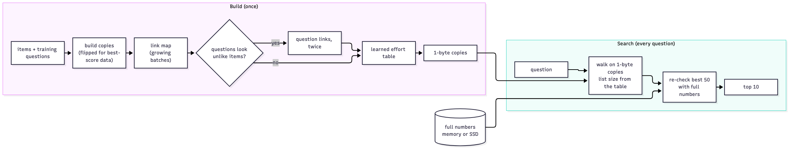
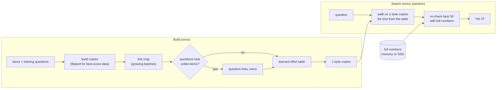

# Architecture

**In one line:** one Rust library holds the whole index; a thin Python package wraps it; a set of Python checks runs each step against the experiments' data and numbers.



<details><summary>Diagram source (mermaid — flowchart)</summary>



</details>

## The parts
```
vector-index-rust/
  crates/vindex/      the index: a plain Rust library, no Python inside
  crates/vindex-py/   the Python package (built with maturin), a thin wrapper
  validate/           Python checks, one per step, reading the experiments' data
  SPEC.md  ARCHITECTURE.md  DESIGN.md  STEPS.md  REPORT.md  README.md
```

## Inside the library
| Module | Job |
|---|---|
| `metric` | distances on full numbers (angle, best score, straight-line), written with the chip's 4-wide vector instructions; the same results, bit for bit, as adding one number at a time |
| `codes` | the 1-byte copies: per-number low and step, encode, prepare a question, distance (vector instructions too) |
| `store` | the full numbers (in memory or a file read on demand) and the build copies |
| `graph` | link slots per item, degree, alive marks, ids; part 3's extra links for popular items |
| `search` | the walk: sorted list, visited marks, check counts, the full-number re-check |
| `score` | how the walk scores items: one at a time or four side by side, plus "start loading" hints |
| `prefetch` | asking the chip to start loading memory early (hints only; results never change) |
| `prune` | DiskANN's rule for picking a few spread-out links, with "keep these first" links |
| `build` | start item, growing batches, out-links in parallel, back-links |
| `qlinks` | the "do questions look unlike items?" test, question links, refresh; part 3's extra links for popular items, worked out from the same answers |
| `effort` | the learned effort: learn the table, search with it |
| `changes` | add, delete with repair right away, update in place, slot reuse |
| `persist` | save and load a folder |
| `usage` | part 2's usage stats: counters and histograms, merged once per search call |
| `audit` | part 2's spot checks: which questions to keep, the accuracy estimates and their margins |
| `tune` | part 2's trials: build a small index per choice, time it at the target, keep the clear winner (after the build, the index itself also times its copy size and, in part 3, its re-check count and extra links) |
| `suggest` | part 2's suggestions: notes from the usage and spot checks, and a settings trial on real questions |
| `layout` | renumbering items after the build so linked items sit near each other in memory |
| `index` | the public `Index` and its `Settings` |

## How the data sits in memory
- **Links:** one flat array of 32-bit slot numbers, 41 slots per item (32 links plus room to grow before pruning), and a 4-byte degree per item.
- **Extra links (part 3):** only when sample answers bunch up on few items: an offset and a count per item, then the popular items' extra links in one flat array (on Llama, about 10 bytes per item in all).
- **Alive marks and ids:** 1 byte and 8 bytes per item; a hash map from id to slot.
- **1-byte copies:** one flat array, `dim` bytes per item, plus `low` and `step` per number.
- **Full numbers:** either a flat in-memory array, or the file `numbers.f32` mapped from disk and read only for the 50 re-checks per search, for building, and for changes.
- **Build copies:** for best-score data, the flipped numbers (x / |x|²), used only when linking (building and changes). They are not needed to search.
- **Training questions:** kept only when question links are on, for the refresh every 3,000 changes.
- **Learned effort table:** a few hundred numbers.

## Threads
- **Searches:** a batch is split across the threads asked for; with one thread it runs on the calling thread itself. Each thread keeps its own working memory (seen marks, list) between calls, so a search allocates and clears nothing.
- **Building:** for each batch of new items, their searches and link choices run in parallel against the map as it was; then the links are written, and the back-links are worked out in parallel and written.
- **Changes:** one at a time (they need exclusive access); searches only read. The Python package guards this with a read-write lock: searches run side by side, a change waits for running searches to finish, and searches wait for a running change.

## Files on disk
A saved index is a folder:
- `meta.bin`: a versioned header with the settings, counts, start item, the learned effort table, the 1-byte copies' low and step per number, and the change counter. It is written last, so a folder without it is never taken for a complete index.
- `links.u32`, `degree.u32`, `alive.u8`, `ids.u64`, `free.u32`: the map.
- `extra_n.u8`, `extra.u32`: popular items' extra links (part 3), only when there are any: how many per slot, then all of them in slot order.
- `codes.u8`: the 1-byte copies.
- `numbers.f32`: the full numbers, in slot order, so a re-check reads one contiguous row.
- `train_q.f32`: training questions, only when question links are on.
- `usage.json`: the usage stats, the spot checks' counts and the spot-checked questions, readable as they are (part 2).
- `checked_q.f32`: the spot-checked questions' numbers, in `usage.json`'s order.
- `tuning.json`: what the build's tuning tried and chose, when it ran.

Format version 2 adds part 2's settings and facts (such as the items' own gap) at the end of `meta.bin` as text pairs, so later ones need no new version; version 1 folders still load. Part 3's `popular_links` is written only when it is not `auto`, so a folder without extra links still loads in a part 2 build.

Everything is little-endian. Loading checks the header's version and every file's size before trusting anything, and reads each file straight into place.

## The Python package
```python
import vindex
idx = vindex.Index(dim, metric="cos", **settings)
idx.build(X, ids, train_questions=None)
ids, dists, checks = idx.search(Q, k=10, target=0.95, threads=1)      # learned effort
ids, dists, checks = idx.search(Q, k=10, list_size=100, threads=1)    # fixed list size
idx.add(id, x); idx.delete(id); idx.update(id, x)
idx.save("folder"); idx = vindex.Index.load("folder", numbers="ssd")
idx.memory()                                                          # bytes, by part
```

## How each step is checked
- **Rust unit tests** (`cargo test`): small made-up data where the right answer is known.
- **Python checks** (`validate/stepN.py`): the real five slices, run through the Python package.
  - They read the prepared data with numpy from the experiments folder.
  - They score accuracy with the same tie rule as the experiments: copied, about 60 lines, in `validate/common.py`.
  - They compare against the experiments' result files.
  - Each writes `validate/results/stepN.json` and prints PASS or FAIL per check.
- **No step starts** until the one before it passes.
