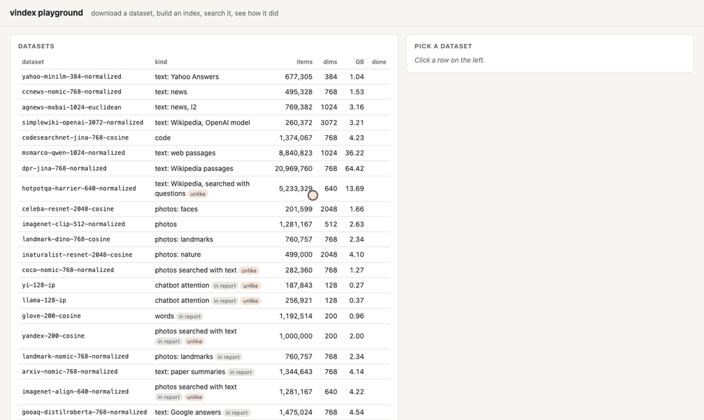
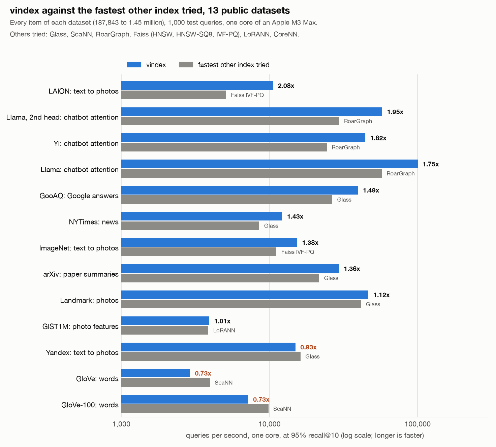

# vindex

**Find the closest matches among millions of items, fast.**

AI models turn a text, a photo or a word into a list of numbers (an *embedding*). Things that mean the same get similar numbers. vindex is a search index for these lists: give it a question as numbers, and it returns the 10 closest items without checking every one.

It is written in Rust, used from Python, and runs on macOS with Apple silicon.



*The playground (`playground/`) in use: it downloads a dataset, builds an index while showing each step, searches it, and checks one question's answers. Waits are sped up about 7×; the page's own clock shows the real time.*

## How fast is it?



How the test was run: 13 public datasets, every item of each, one core of an M3 Max. Each index had to find 95% of the true 10 closest items.
- **Faster than the fastest other index on 11 of 13:** 1.08× to 2.19× its speed. The index was never tuned on 8 of the 13: they were held back until it was finished.
- **6.8× to 17.4× as fast as HNSW,** the best-known method, wherever HNSW finds 95%. On the three chatbot datasets it never does.
- **Slower on two:** ScaNN is 1.36× and 1.37× as fast on the two GloVe word datasets.

<details><summary><b>The numbers:</b> searches per second at 95%</summary>

| Dataset | vindex | Fastest other index | vindex ÷ it | HNSW | vindex ÷ HNSW |
|---|---|---|---|---|---|
| LAION: text to photos | 10,566 | Glass 4,833 | **2.19×** | 801 | 13.2× |
| Llama, 2nd head: chatbot attention | 57,607 | RoarGraph 29,507 | **1.95×** | never reaches 95% | – |
| Yi: chatbot attention | 44,284 | RoarGraph 24,371 | **1.82×** | never reaches 95% | – |
| Llama: chatbot attention | 100,112 | RoarGraph 57,226 | **1.75×** | never reaches 95% | – |
| ImageNet: text to photos | 15,379 | Glass 9,068 | **1.70×** | 985 | 15.6× |
| GooAQ: Google answers | 39,545 | Glass 26,512 | **1.49×** | 3,221 | 12.3× |
| NYTimes: news | 12,169 | Glass 8,523 | **1.43×** | 701 | 17.4× |
| arXiv: paper summaries | 29,407 | Glass 21,627 | **1.36×** | 2,694 | 10.9× |
| GIST1M: photo features | 3,921 | Glass 2,905 | **1.35×** | 302 | 13.0× |
| Landmark: photos | 46,560 | Glass 34,762 | **1.34×** | 5,194 | 9.0× |
| Yandex: text to photos | 14,971 | Glass 13,872 | **1.08×** | 2,187 | 6.8× |
| GloVe: words | 2,907 | ScaNN 3,956 | 0.73× | 297 | 9.8× |
| GloVe-100: words | 7,184 | ScaNN 9,828 | 0.73× | 1,012 | 7.1× |

Made by `tools/draw_report.py readme` from `validate/results/` (step 42 for vindex, step 30 for the others).
</details>

**How it was measured**
- **Questions:** 1,000 test questions per dataset, never used for building or tuning.
- **Settings:** vindex picked its own, from sample questions, the same way on every dataset. Each other index tried up to 9 settings, and its fastest that reached 95% counts. Their authors may know better ones.
- **Same machine:** every index ran on the same Mac, one core. ScaNN ran in a Linux container on it.
- **Datasets:** 187,843 to 1.45 million items each: text, photos, words, news and chatbot attention, from [VIBE](https://vector-index-bench.github.io) and [ann-benchmarks](https://github.com/erikbern/ann-benchmarks).

**Where it is not better**
- **Build time:** it took longer to build than the fastest other index on all 12 datasets where both were timed: 1.5× (GIST1M) to 23× (Yi). Trying settings is part of it: on 100,000-item samples, builds took 2.6–7× longer with it. `tune="off"` skips it, at a cost in speed.
- **Memory:** with everything in memory, about as much as Glass or a little less, and more than RoarGraph and ScaNN. It can leave the full numbers on SSD, using 0.17–0.70× HNSW's memory, but then answers 2–23× fewer searches per second.
- **Unreachable items:** a few items can't be found by any search: 0 to 1,209 per dataset, out of up to 1.45 million (GIST1M has the most).
- **One platform:** built and tested only on macOS with Apple silicon.

**More detail:**
- `WRITE-UP.md`: one page for newcomers.
- `REPORT.md`: every table, from part 1 to part 5.
- [The results page](https://srir84.github.io/vector-index-rust/page/results.html): every number, with a chart for each dataset (`page/results.html`).

## Get started

### 1. Install
Needs a Mac with Apple silicon, [rustup](https://rustup.rs), [uv](https://docs.astral.sh/uv/) (or plain `pip`), and Python 3.10 or newer.

```sh
git clone https://github.com/srir84/vector-index-rust.git
cd vector-index-rust
uv venv --python 3.13 .venv                          # or: python3 -m venv .venv
uv pip install --python .venv numpy maturin h5py     # or: .venv/bin/pip install numpy maturin h5py
tools/build_py.sh                                    # builds the package into .venv and checks it loads
```
The last line should print `vindex 0.1.0 built and loads`. The first build downloads the Rust version pinned in `rust-toolchain.toml` (a nightly; the file says why). `h5py` is only for the playground below.

For 1–7% more speed, `tools/build_py_pgo.sh` builds it guided by a practice run (needs `rustup component add llvm-tools-preview`).

### 2. Try it on a public dataset
The playground downloads a dataset, builds an index on it, searches it, and checks every answer against the true ones:
```sh
.venv/bin/python playground/play.py list                               # 22 datasets: text, photos, code, chatbot
.venv/bin/python playground/play.py run yahoo-minilm-384-normalized    # 1 GB; about 5 minutes
.venv/bin/python playground/play.py ui                                 # or use the browser page: http://127.0.0.1:8035/
```
It shows each build step as it runs. Then it shows the memory, the settings the index picked, and, at each target, the share of the true top 10 found and the searches per second. `playground/README.md` has the steps, the datasets, and how to use your own file.

### 3. Use it in your own code
```python
import numpy as np
import vindex

rng = np.random.default_rng(0)
X = rng.standard_normal((20_000, 64), dtype=np.float32)       # items: one row of numbers each
ids = np.arange(len(X))                                        # their ids: whole numbers, 0 or more
train = rng.standard_normal((2_000, 64), dtype=np.float32)     # sample questions, never your test ones
Q = rng.standard_normal((100, 64), dtype=np.float32)           # questions

idx = vindex.Index(64, metric="cos")                           # "cos" (angle), "ip" (best score) or "l2"
idx.build(X, ids, train_questions=train)                       # uses all cores; threads=N to limit

found, dists, checks = idx.search(Q, k=10, target=0.95)        # effort learned per question, aiming at 95%
found, dists, checks = idx.search(Q, k=10, list_size=100)      # or one fixed effort for every question
found, dists, checks = idx.search(Q, k=10, target=0.95, threads=8)   # spread the questions over 8 cores

idx.add(1_000_000, rng.standard_normal(64, dtype=np.float32))  # changes, one at a time
idx.delete(0)
idx.update(1, rng.standard_normal(64, dtype=np.float32))

print(idx.build_progress())                                    # from another thread while build() runs: phase, step, done, total
idx.save("my_index")                                           # a folder
idx = vindex.Index.load("my_index", numbers="ssd")             # full numbers stay on SSD: search only
print(idx.memory())                                            # bytes kept in memory, by part
print(idx.stats())
```

- **Numbers:** `float32` only (convert with `.astype(np.float32)`; `float64` is refused), every row the same length, no NaN or infinity. Questions must come from the same model as the items, or its paired model (for example CLIP's text and image halves).
- **Metric:** the one the model was made for. `cos` suits most text and image models; `ip` is for models scored by a plain dot product; `l2` is straight-line distance.
- **Answers:** `found` holds ids (`-1` where fewer than `k` exist), `dists` their distances (smaller is closer), `checks` the work per question.
- **Training questions** are needed for the learned effort. Without them, pass `learned_effort=False` and search with `list_size=`.
- **Threads:** searches from several Python threads run side by side; a change waits until running searches finish.
- **On SSD:** an index loaded with `numbers="ssd"` searches only; load it with `numbers="ram"` (the default) to change it.

## How it works
- **Links:** when it builds, it links each item to a few similar items (DiskANN's method). A search starts at one item and keeps moving to whichever linked item is closer to the question.
- **Small copies:** on the way it compares 1-byte (or 4-bit) copies of the numbers, then re-checks the best few with the full numbers. The full numbers can stay on SSD.
- **Effort per question:** hard questions get a longer search, easy ones a shorter one, from a table learned on sample questions.
- **Links between answers:** when questions look unlike the items (for example text searching photos), it also links each sample question's answers to each other.
- **Repairs on delete:** a deleted item's neighbours are re-linked right away, each new link kept only where it reaches a new way.

`DESIGN.md` explains each part and every default. The ideas were first tried in a separate experiments repository, which is not public yet.

### It fits itself to your data
- **At build** (`tune="auto"`, the default): with at least 10,000 items and 800 sample questions, it tries a few choices of links per item and slack on a trial sample of the items (a fifth of them, at least 20,000 and at most 100,000) and keeps the fastest at 95%. After the build, on the real index, it tries 4-bit copies, fewer re-checks, and, when the sample answers bunch up on a few items, extra links between those popular items. A close call is timed longer, and a new choice replaces the one in use only when clearly faster, so fresh builds mostly pick the same settings. `idx.tuning()` shows what it tried. Builds take 2.6–7× longer than without it on the 100,000-item samples; with it, the full-size builds took under a minute (Llama) to 15 minutes (GIST1M) on all cores.
- **In use:** it keeps usage stats, and sets aside a few searches for spot checks (up to about 2% of the search work). `idx.audit()` checks those against every item; when they show a target missed, it learns its effort table again. `idx.suggest()` suggests rebuilds with their measured gain.
- **A target is aimed at, not promised:** in the playground, Yahoo's target 0.95 found 93.6% of the true top 10. For the benchmark, the index picked each dataset's target on tuning questions, and the test questions then found 94.68% to 96.24%.

```python
print(idx.usage())                  # searches, checks, time per search, how hard and how "unlike the items" questions are
print(idx.audit())                  # spot checks so far: accuracy per target, with a margin of error
idx.relearn_effort()                # learn the effort table from the spot-checked questions (audit() does this when a target is missed)
for s in idx.suggest():             # notes, and a rebuild when a trial shows it is at least 15% faster
    print(s["what"], s["why"])
real = idx.checked_questions()      # the spot-checked questions, to rebuild with when a suggestion says so
```

### Settings
Pass them as keywords, e.g. `vindex.Index(64, "cos", r=48, rerank=100)`. The main ones:

| Setting | Default | What it does |
|---|---|---|
| `r` | 32 | links per item |
| `l_build` | 200 | effort while building: higher makes a better map, more slowly |
| `alpha` | 1.2 | how spread out each item's links must be |
| `rerank` | 50 | how many of the best are re-checked with the full numbers (the tuning also tries 15 and 25) |
| `learned_effort` | true | learn the effort table at build (needs training questions) |
| `question_links` | auto | links between training questions' answers: `auto`, `on` or `off` |
| `build_space` | auto | links for best-score data built on flipped copies: `auto`, `same` or `flipped` |
| `seed` | 7 | the build order's random seed |
| `tune` | auto | pick links, slack and copy size at build: `auto` or `off` |
| `max_bytes_per_item` | 0 | the tuning skips choices that keep more memory than this (0: no limit) |
| `question_bits` | 16 | a question as 16-bit whole numbers against the copies (32: floats, 8: 8-bit) |
| `code_bits` | 8 | copies of 8 bits, or 4 (two numbers per byte; picked by the tuning when faster), or 0 (full numbers) |
| `audit_budget` | 0.02 | spot checks may cost this share of the search work (0: off) |
| `relearn_every` | 500 | after this many new spot checks, relearn the effort table if a target is missed (0: never) |
| `track_usage` | true | keep the usage stats |
| `effort_apart` | true | learn the effort table on sample questions the question links do not use |
| `renumber` | true | put linked items next to each other in memory after the build |
| `popular_links` | auto | extra links between popular items (those in the sample questions' answers): `auto` (when those answers bunch up on a few items, kept if faster), `on` or `off` |
| `repair` | occlude | how a delete re-links its neighbours: `occlude` (take a replacement only where it reaches a new way), `append` (parts 1 to 4) or `prune` |
| `n_replace` | 8 | replacement links a delete offers each neighbour (parts 1 to 4: 3) |

`DESIGN.md` explains every setting and how each part works.

### The bucket search (an experiment)
`idx.build_buckets()` and `idx.search_buckets(Q, k=10, n_probe=8, pool=100)` group the items into buckets and scan the nearest buckets' 4-bit codes, as ScaNN does. They are kept only so steps 39 and 40 can be rerun. `search` never uses them, and they are not saved, changed or tuned with the index (`DESIGN.md` section 23).

## Use from Rust
`crates/vindex/examples/basic.rs` builds, searches, changes, saves and loads:

```sh
cargo run --release -p vindex --example basic
```

## Checking it
```sh
cargo test -p vindex --release      # unit tests on small made-up data
REUSE_GRID=1 validate/run_all.sh    # each build step's check, against the experiments' recorded results
validate/run_all.sh 9 10            # or just some steps
```

- **`validate/run_all.sh`** needs `../vector-index-experiments` with its prepared data. That repository is not public yet, so for now these checks can only be read: their results are in `validate/results/`. `cargo test` and the playground need nothing else. With the data, `run_all.sh` takes about an hour and a half.
  - `REUSE_GRID=1` reuses steps 18 and 21's saved grids: every choice of links, slack and copy size, built at full size and timed. Without it, they are made again, which takes about an hour more.
- **Steps that time searches** (11, 12, 18 to 21 and 24 to 26) should run on an otherwise idle machine.
- **The held-back tests and full-size runs are not part of it.** Each is meant to run once:
  - part 2: `validate/step22.py rivals`, then `validate/step22.py`;
  - part 3: `validate/step27.py rivals`, then `validate/step27.py`;
  - part 4: steps 28 to 32 (`validate/step29.py`, `validate/step30.py rivals`, then `validate/step30.py`, and so on);
  - part 5: `validate/step42.py ours`, `validate/step42.py changes` and `validate/step42.py rivals`, then `validate/step42.py`. These take about 6 hours.
  - ScaNN runs in Docker, which must be running for the rivals' runs.
- **The reports' numbers are checked too:** `validate/step33.py` (the results page) and `validate/step43.py` (`REPORT.md` part 5 and `WRITE-UP.md`) check every number against the results files. Since step 44 changed the code after the freeze, `step43.py`'s first check ("the code is as frozen") fails; `STEPS.md` step 44 shows the change builds the same index.
- **`STEPS.md`** says what each step checks and what it found.

## Files
| File | What it holds |
|---|---|
| `SPEC.md` | what the index must do, and the targets |
| `ARCHITECTURE.md` | the parts and how data sits in memory and on disk |
| `DESIGN.md` | how each part works, with the default settings |
| `STEPS.md` | the build steps (0 to 43, in five parts, and 44 after the freeze), each one's check and result |
| `REPORT.md` | results for all five parts, newest first: against the rivals on 13 datasets, met and missed targets |
| `WRITE-UP.md` | one page for readers new to it, with a link to the results page |
| `playground/` | try it on a public dataset or your own file, from the command line or a browser page |
| `demo/` | ask questions of GooAQ's 1.45 million Google answers on your own machine |
| `crates/vindex` | the index (Rust library) |
| `crates/vindex-py` | the Python package |
| `validate/` | one check per step, plus `run_all.sh` |
| `tools/` | `build_py.sh` and `build_py_pgo.sh` (build the package), `draw_report.py` (the report's and README's charts), `results_page.py` (the results page), `record_playground.py` (the playground recording) |

## License
MIT (`LICENSE`). The datasets have their own licences: see each source.
