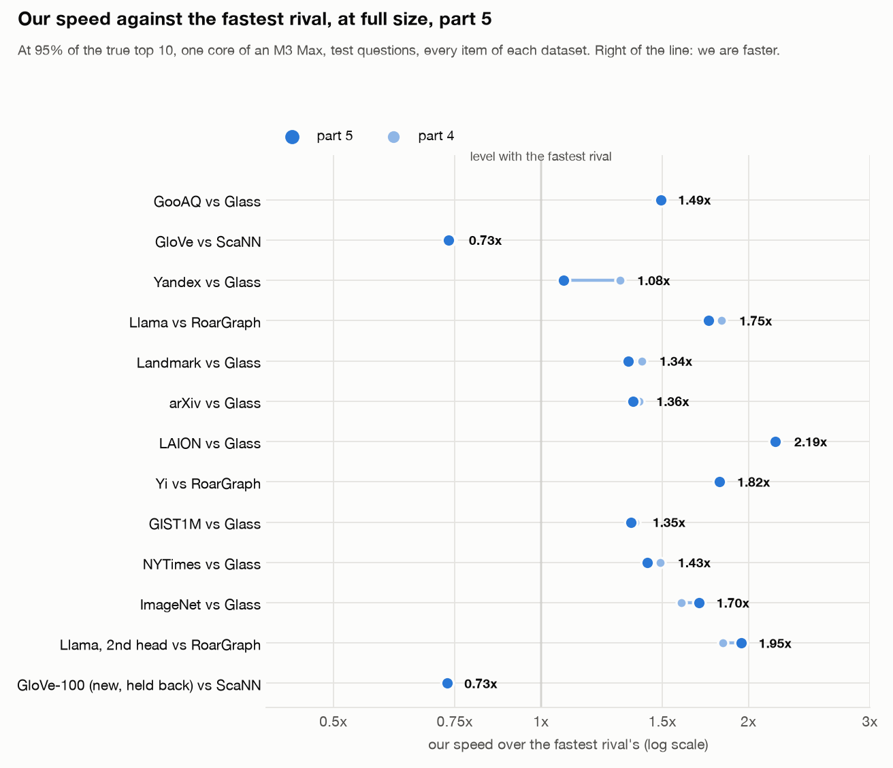
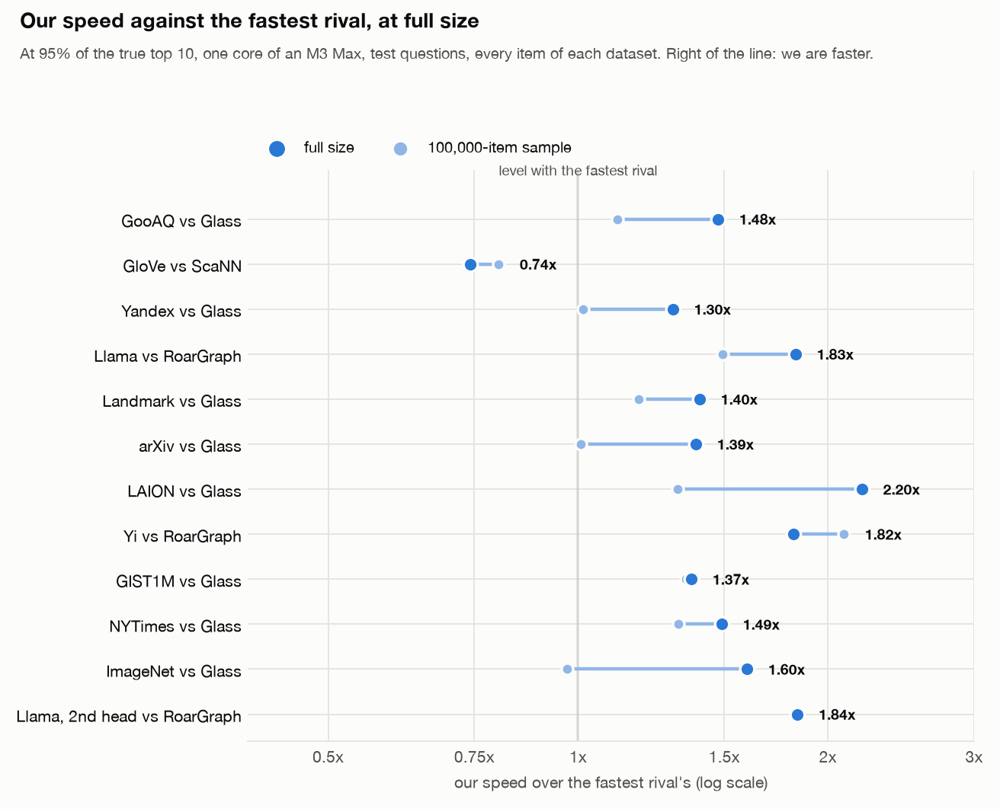
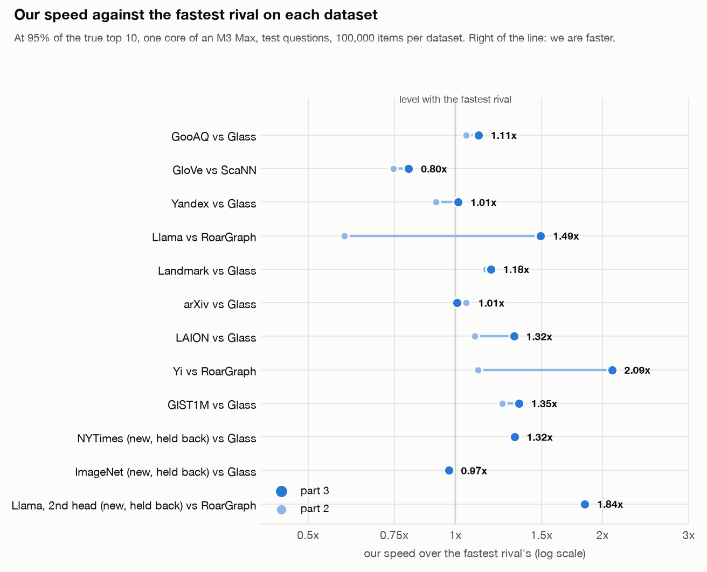
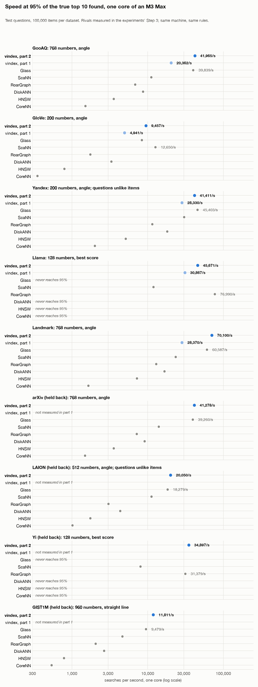
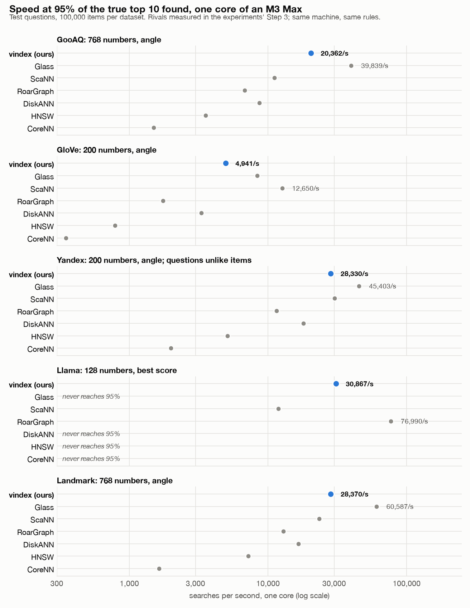

# Report

Five parts:
- **Part 5** (first below) makes fresh builds steadier and fixes the change test on Landmark, then runs our side at full size again, with one more held-back dataset, GloVe-100.
- **Part 4** runs everything on the full datasets instead of 100,000-item samples, then shares the results: a results page, a demo and a one-page write-up (`WRITE-UP.md`).
- **Part 3** goes after the three rivals that were still faster after part 2. At the end it was tested on three new datasets nobody tuned on.
- **Part 2** is the index that picks its own settings and keeps itself on target, tested on four held-back datasets.
- **Part 1** (further down) is the first Rust build, with one setting for every dataset.

# Part 5: steady builds, the change test, and GloVe-100

**In one line:** still ahead of the fastest rival on the same eleven datasets, and the change test now passes on all thirteen. GloVe is still lost to ScaNN (0.73×), and so is the new held-back GloVe-100 (0.73×). Fresh builds are steadier but not fully steady.

## The targets in SPEC.md, part 5

| Target | Result |
|---|---|
| Steady: three fresh builds of each dataset pick the same settings; at full size, Yandex and ImageNet within 3% | **Missed, narrowly.** 11 of 12 samples pick the same settings every time (5 of 12 before). ImageNet's sample still flips. At full size, Yandex made the same picks three times but timed 3.2% apart; ImageNet's picks differed but were within 0.6%. |
| Changes: drift under 1 point on all twelve at full size | **Met,** on all thirteen. Landmark −0.63 (part 4: −1.08). |
| GloVe: the bucket search picked there, at least 1.25× part 4's speed | **Missed.** The bucket search reached only 0.88× ScaNN on full GloVe, so by the rule agreed for it, it was not built in. GloVe is 0.99× part 4. |
| No losses: still ahead of the fastest rival on the eleven won in part 4 | **Met.** 1.08× (Yandex) to 2.19× (LAION). |
| GloVe-100: the expected result written first, the first run reported as it comes | **Done.** 0.73× ScaNN, 0.93× Glass, 7.1× HNSW. Of the 8 expectations, 4 were right (below). |

## Speed
Measured as in part 4: test questions, batches of 1,000, middle of 5 timed runs, read off at exactly 95%, one core. The rivals' runs are part 4's, except GloVe-100's, which ran in part 5. Searches per second:

| Dataset | Items | Part 5 | Part 4 | Part 5 ÷ part 4 | Fastest rival | Part 5 ÷ rival | Checks per search |
|---|---|---|---|---|---|---|---|
| GooAQ | 1,454,024 | 39,545 | 39,116 | 1.01 | Glass 26,512 | 1.49 | 523 |
| GloVe | 1,171,514 | 2,907 | 2,936 | 0.99 | ScaNN 3,956 | 0.73 | 12,461 |
| Yandex | 1,000,000 | 14,971 | 18,057 | 0.83 | Glass 13,872 | 1.08 | 2,127 |
| Llama | 256,921 | 100,112 | 104,715 | 0.96 | RoarGraph 57,226 | 1.75 | 655 |
| Landmark | 739,757 | 46,560 | 48,733 | 0.96 | Glass 34,762 | 1.34 | 352 |
| arXiv | 1,323,643 | 29,407 | 30,005 | 0.98 | Glass 21,627 | 1.36 | 694 |
| LAION | 1,000,448 | 10,566 | 10,628 | 0.99 | Glass 4,833 | 2.19 | 2,291 |
| Yi | 187,843 | 44,284 | 44,290 | 1.00 | RoarGraph 24,371 | 1.82 | 1,343 |
| GIST1M | 979,000 | 3,921 | 3,980 | 0.99 | Glass 2,905 | 1.35 | 3,815 |
| NYTimes | 268,761 | 12,169 | 12,702 | 0.96 | Glass 8,523 | 1.43 | 3,517 |
| ImageNet | 1,281,167 | 15,379 | 14,499 | 1.06 | Glass 9,068 | 1.70 | 1,240 |
| Llama, second head | 256,921 | 57,607 | 54,188 | 1.06 | RoarGraph 29,507 | 1.95 | 1,225 |
| GloVe-100 | 1,162,514 | 7,184 | | | ScaNN 9,828 | 0.73 | 8,067 |

- **Where the picks were part 4's** (GooAQ, Landmark, arXiv, Yi and Llama's second head: the same index), the speed still moved 0.96–1.06×. That is the timing noise between two runs a day apart, with a macOS storage scan using 0.96–4.34 other cores.
- **Yandex fell to 0.83× part 4** (still 1.08× Glass). Part 4's build was a lucky one. This build picked 96 links and slack 1.2, and needs 2,127 checks per search against 1,733 (next section).
- **On the test questions,** the target picked on the tuning questions found 94.68% (Yandex) to 96.24% (Llama's second head) of the true top 10.

## Steady builds
Part 4's index could be 11.3% faster or slower from one fresh build to the next (step 30b), because its setting search, which times trial builds, kept the faster of two close choices by any margin.
- **The fix** (`DESIGN.md` section 16): ties within 2% go to the plainer choice; close calls, within 1.5% of a bar, are timed 20 rounds longer; and when new links lose the final test, slack is tried again on the old links.
- **Three fresh builds of each sample** made the same picks on 11 of 12 datasets (5 of 12 before the fix, 8 of 12 with only the first rule). Those eleven were within 1.0% of each other, timed head to head.
- **ImageNet's sample still flips.** One choice, slack 1.3 against 1.2, measured 3.4% to 6.1% faster against a 5% bar. The true gap sits on the bar, so no amount of timing settles it.
- **At full size,** Yandex's three builds made the same picks, yet timed 3.2% apart: at full size the head-to-head check has about 3% noise of its own. ImageNet's three builds picked different copy sizes but were within 0.6%.
- **Yandex flipped again in the frozen run:** it picked 96 links where step 37's three builds picked 48, and is 8.3% slower than the slowest of them. In its links trial, 48 and 96 ended 0.14% apart. But its first round put 96 more than 3.5% ahead, outside the close-call window, so it was never timed longer.

## Changes at full size
As in part 4: built on 90% of the items, then 10% more added, 10% deleted and 10% updated, in one mixed order, and compared with a fresh build of the final items (step 42).
- **Passed on all thirteen.** Nothing deleted or outdated came back at any checkpoint. Memory was 1.001–1.006× a fresh build's.
- **Drift, in points:** GooAQ −0.46, GloVe +0.09, Yandex −0.64, Llama −0.37, Landmark −0.63, arXiv +0.13, LAION −0.60, Yi −0.42, GIST1M +1.02, NYTimes −0.35, ImageNet −0.90, Llama's second head −0.69, GloVe-100 −0.10.
- **The fix for Landmark** (step 38): when an item is deleted, its neighbours used to get 3 replacement links added to the end of their lists. That crowded out good links. Now they get up to 8, each kept only if it reaches a new way, from where none of the other links already lead.
- **Elsewhere** the drift moved by 0.29 points or less from part 4's, either way, all well inside the rule.

## GloVe and the bucket search
ScaNN wins on GloVe by grouping the items into buckets around centres and scanning the closest buckets' short codes, instead of walking links. We built that way of searching into the same index (steps 39 and 40):
- **On GloVe's sample** it matched the link walk (1.02×). On NYTimes it was far slower, so the index would have had to pick between the two per dataset.
- **On full GloVe,** with the buckets trained harder, it reached 1.17× our link walk, but only 0.88× ScaNN.
- **Not built in:** the rule agreed for it was to build it in only if it beat ScaNN. Its code stays as a recorded experiment (`buckets.rs`).

## GloVe-100, the held-back dataset
The same Twitter words as GloVe, from a separately trained model with 100 numbers per word. It was locked before any part 5 code change and run once at the end.

| Index | One core at 95% | All cores | Memory per item, bytes | Settings |
|---|---|---|---|---|
| ScaNN | 9,828 | 60,151 | 456 | 3,488 buckets |
| Glass | 7,754 | 63,440 | 960 | 96 links |
| **vindex** | **7,184** | **57,034** | **972 (572 with the full numbers on SSD)** | 96 links, slack 1.3, 4-bit copies |
| HNSW | 1,012 | 9,113 | 816 | 96 links |

- **As expected,** ScaNN is fastest there, then Glass. We are 7.1× HNSW, and the change test passes (−0.10).
- **Not expected:** we hoped to be within 10% of ScaNN, which assumed the bucket search was built in. Glass is also slightly ahead of us (0.93×).

## What we expected, written before any part 5 code change
Step 36 wrote these down (`STEPS.md`); steps 37 and 42 mark them (`validate/results/step42-expectations.json`).
- **Right:**
  - Landmark's drift came from the links the repair after a delete left weak, not from the effort table;
  - on GloVe-100, ScaNN is the fastest rival, then Glass;
  - on GloVe-100, at least 5× as fast as HNSW, and the change test passes;
  - still ahead of the fastest rival on the other eleven.
- **Half right:** which choices flip. The re-check count flipped under the first rule, as expected, but not under the final one. What still flips is slack, on ImageNet, not Yandex.
- **Wrong:**
  - GloVe 1.25–1.5× part 4's speed, within 10% of ScaNN: 0.99× and 0.73×;
  - the bucket search picked on GloVe and GloVe-100 only: not built in;
  - GloVe-100 within 10% of ScaNN: 0.73×.
- **Too mild:** "steadier picks may cost a few percent where part 4's builds were lucky (Yandex)". Yandex fell 17%.

## Memory
The picks moved on seven of the twelve datasets, but memory moved on only two, with everything in memory:
- **Yandex:** 1,508 bytes per item (part 4: 1,260), from 96 links instead of 48.
- **ImageNet:** 3,460 (part 4: 3,376), from 48 links instead of 32.
- **The other ten** use exactly what they did in part 4. The full table is on the results page.

## What part 5 missed
- **GloVe and GloVe-100:** ScaNN is 1.36× and 1.37× as fast as we are. The bucket search was not good enough to build in.
- **Steady builds:** 11 of 12 samples are steady. ImageNet's sample still flips, and Yandex's full-size build in the frozen run picked differently from three made just before it. A wider close-call window would have caught Yandex's.
- **Yandex:** 17% slower than part 4, though still ahead of Glass.
- **Of the 8 expectations,** 3 were wrong and 1 half right.

## How these numbers were made
- **Machine:** as part 4 (`validate/results/machine.json`). The code was frozen again before the full-size runs (`validate/results/step42-frozen.json`).
- **Ours:** `validate/step42.py ours` (90 minutes for all thirteen); `validate/step42.py changes` (3.3 hours).
- **GloVe-100's rivals:** `validate/step42.py rivals` runs the experiments' `scripts/step7_baselines.py` (47 minutes). The check is `validate/step42.py`.
- **Steady builds:** `validate/step37.py` (samples) and `validate/step37.py full`.
- **The results page:** `tools/results_page.py`, checked by `validate/step33.py`. **The picture:** `../vector-index-experiments/.venv/bin/python -I tools/draw_report.py part5`.
- **This part and `WRITE-UP.md`:** `validate/step43.py` recomputes every cell of the two tables above from the results files, and checks that every other number in them comes from the results files.

---

# Part 4: the full-size test

**In one line:** with every item of all twelve datasets (187,843 to 1.45 million), at 95% of the true top 10 on one core, the index is ahead of the fastest rival on eleven. Only ScaNN on GloVe is faster, by 1.35×.

## The targets in SPEC.md, part 4

| Target | Result |
|---|---|
| Faster than HNSW at 95% wherever it reaches 95% | **Met.** 8.26–18.12× on the nine where it does. On the three attention datasets it never does (best 26.9–49.0%). |
| Against the fastest rivals: no target; checked against the expectations written first | Ahead on 11 of 12 (1.30–2.20×), behind ScaNN on GloVe (0.74×). Of the 13 expectations written first, 6 were right (below). |
| Changes: drift under 1 point, nothing deleted or old returned, memory within 5% | **Missed on one of twelve.** Landmark drifted −1.08 points. Nothing deleted or old came back anywhere, and memory was 1.001–1.006× a fresh build's. |
| Results page: every number read from the results files, checked by a script | **Met.** 358 different numbers, each recomputed from the results files by `validate/step33.py`. |
| Demo: its answers are the index's own, with the time shown | **Met.** For 100 of GooAQ's own questions, the demo showed the same 10 answers in the same order as the indexes' own searches, for vindex and for HNSW, and each text shown is the one its numbers were made from (step 34). |

## Speed
Measured as in parts 1 to 3: test questions, batches of 1,000, middle of 5 timed runs, read off at exactly 95%, one core. Searches per second:

| Dataset | Items | Full size | Sample | Fastest rival, full size | Full size ÷ rival | Sample ÷ the same rival | Checks per search |
|---|---|---|---|---|---|---|---|
| GooAQ | 1,454,024 | 39,116 | 44,410 | Glass 26,512 | 1.48 | 1.11 | 523 |
| GloVe | 1,171,514 | 2,936 | 10,154 | ScaNN 3,956 | 0.74 | 0.80 | 12,662 |
| Yandex | 1,000,000 | 18,057 | 46,009 | Glass 13,872 | 1.30 | 1.01 | 1,733 |
| Llama | 256,921 | 104,715 | 115,028 | RoarGraph 57,226 | 1.83 | 1.49 | 668 |
| Landmark | 739,757 | 48,733 | 71,624 | Glass 34,762 | 1.40 | 1.18 | 352 |
| arXiv | 1,323,643 | 30,005 | 39,573 | Glass 21,627 | 1.39 | 1.01 | 694 |
| LAION | 1,000,448 | 10,628 | 24,075 | Glass 4,833 | 2.20 | 1.32 | 2,281 |
| Yi | 187,843 | 44,290 | 65,599 | RoarGraph 24,371 | 1.82 | 2.09 | 1,343 |
| GIST1M | 979,000 | 3,980 | 12,784 | Glass 2,905 | 1.37 | 1.35 | 3,805 |
| NYTimes | 268,761 | 12,702 | 11,847 | Glass 8,523 | 1.49 | 1.32 | 3,531 |
| ImageNet | 1,281,167 | 14,499 | 32,562 | Glass 9,068 | 1.60 | 0.97 | 1,200 |
| Llama, second head | 256,921 | 54,188 | 78,538 | RoarGraph 29,507 | 1.84 | 1.84 | 1,225 |

- **Which rivals ran** was fixed from the samples, before any full-size run: the fastest on each dataset, ScaNN on NYTimes (within 1.3× of Glass there), HNSW on all twelve and CoreNN on GIST1M. Each searched its settings again on the full items (step 30).
- **None is level any more:** in the samples, Yandex, arXiv and ImageNet were within 5% of Glass. At full size we are 1.30–1.60× as fast.
- **Glass on Landmark:** its quickest setting already finds 96.72%, so its speed is that setting's.
- **Timed again, head to head (step 30b):** our runs and the rivals' were hours apart, so the two biggest moves from the samples were timed again, Glass then ours, one right after the other.
  - ImageNet came out at 1.86× (1.60× the first time), and Yandex at 1.10× (1.30×).
  - Glass moved by up to 4.7%.
  - Ours moved by up to 11.3%. It was built again from scratch, and its setting search, which times trial builds, picked differently: on Yandex its checks per search went from 1,733 to 2,117.
  - Built with step 29's picks fixed (step 30c), it gave step 29's answers and work exactly, and came within 1.0% of its speed.
  - Every win held both times. The tables keep the first runs.
- **Our own speed fell** from the samples' by 1.10× (Llama) to 3.46× (GloVe); NYTimes got slightly faster (0.93×). It is mostly more checks per search: GloVe 12,662 against 5,655, GIST1M 3,805 against 1,451.
- **Other programs** (a macOS storage scan) used 0.8–3.1 cores during our runs; `validate/results/step29.json` records it per dataset.

| Dataset | All 16 cores (searches/s) | Time per question, typical / slow (ms) | Build on all cores |
|---|---|---|---|
| GooAQ | 258,184 | 0.033 / 0.061 | 10.6 min |
| GloVe | 22,368 | 0.266 / 0.975 | 6.8 min |
| Yandex | 161,209 | 0.061 / 0.164 | 2.8 min |
| Llama | 690,946 | 0.014 / 0.021 | 29 s |
| Landmark | 220,309 | 0.025 / 0.046 | 4.7 min |
| arXiv | 206,800 | 0.041 / 0.067 | 9.3 min |
| LAION | 75,201 | 0.099 / 0.196 | 6.4 min |
| Yi | 433,432 | 0.029 / 0.047 | 31 s |
| GIST1M | 14,320 | 0.273 / 0.553 | 13.2 min |
| NYTimes | 135,643 | 0.069 / 0.290 | 2.6 min |
| ImageNet | 95,363 | 0.069 / 0.245 | 7.4 min |
| Llama, second head | 453,249 | 0.028 / 0.042 | 37 s |

- **All-cores and per-question figures** use the target picked on the tuning questions. On the test questions it found 94.98% (Yi) to 96.25% (ImageNet) of the true top 10.
- **"Slow"** is the slowest 1 question in 100.

## Why the lead over Glass grew
- **In the samples** we were level with Glass on Yandex, arXiv and ImageNet (0.97–1.01×). At full size we are 1.30–1.60× as fast.
- **Glass's checks slowed down more than ours:**
  - From the sample to full size, Glass's time per check rose to 1.29–1.71 times the sample's on its eight datasets; ours rose to 0.97–1.42 times.
  - Checks per search grew about as much for both, or a little less for Glass, except on Yandex, LAION and ImageNet: there Glass needed 2.12–2.33 times the sample's checks, and we 1.78–1.93 times.
- **It is not mainly our memory layout.** After the build, our index renumbers its items so that items that link to each other sit close together in memory. Part 1 guessed this "should matter more beyond" the chip's caches (`DESIGN.md`). With renumbering off, the same index answered 4.3% (GooAQ) and 3.6% (Yandex) fewer questions per second on one core (step 30c).
- **The rest is not pinned down.** Both indexes picked their settings again on the full items. Ours picked differently from the samples on nine datasets.

## Against each rival
- **Glass,** the fastest rival on eight datasets: we are ahead on all eight, by 1.30× (Yandex) to 2.20× (LAION).
- **RoarGraph,** the fastest on the three attention datasets: 1.82–1.84×.
- **ScaNN:** on GloVe it is 1.35× as fast as we are (1.25× in the samples). On NYTimes it is slower than Glass (4,264 against 8,523 searches/s) and than us (12,702).
- **HNSW:** we are 8.26–18.12× as fast wherever it reaches 95%. On the three attention datasets it never does.
- **CoreNN, on GIST1M with its author's own settings** (step 31): "On GIST1M, the dataset CoreNN's author tested on, our index answers 17.1x as many questions per second as CoreNN at 95% of the true top 10 (one core), and uses 76% less memory with the full numbers on SSD (9% less with them in memory too)."

## What we expected, written before the runs
Step 28 wrote these down before any full-size run (`STEPS.md`); step 30 marks them (`validate/results/step30-expectations.json`).
- **Right:**
  - still ahead of Glass on GooAQ, Landmark, LAION, GIST1M and NYTimes;
  - still ahead of RoarGraph on the three attention datasets, by 1.3× or more;
  - on NYTimes, ScaNN still slower than Glass;
  - at least 5× as fast as HNSW, which still never reaches 95% on the attention datasets;
  - the extra links switch on only on the three attention datasets;
  - at least 10× as fast as CoreNN on GIST1M, with less memory (step 31).
- **Wrong:**
  - our speed would fall 1.5–3× on the eight big datasets and less on the small ones: it fell 1.14–3.46× on the big ones, and NYTimes got faster;
  - our ratio to Glass would stay within about 15% of the samples': it grew by more than that on six of eight;
  - so Yandex, arXiv and ImageNet would stay level: we are 1.30–1.60× ahead;
  - ScaNN's lead on GloVe would shrink: it grew from 1.25× to 1.35×;
  - memory per item would stay within 10% of the samples': it moved more on six datasets, because the index picked different settings;
  - builds would take 10–25× the samples' time: they took 5–10×;
  - the change test would pass everywhere: Landmark missed.

## Memory
Bytes per item, as counted from what each index holds:

| Dataset | Ours, full numbers on SSD | Ours, all in memory | Fastest rival | HNSW |
|---|---|---|---|---|
| GooAQ | 560 | 3,632 | Glass 3,968 | 3,233 |
| GloVe | 708 | 1,508 | ScaNN 909 | 1,216 |
| Yandex | 460 | 1,260 | Glass 1,472 | 1,088 |
| Llama | 271 | 783 | RoarGraph 522 | 928 |
| Landmark | 904 | 3,976 | Glass 3,968 | 3,233 |
| arXiv | 560 | 3,632 | Glass 3,968 | 3,233 |
| LAION | 772 | 2,820 | Glass 2,816 | 2,336 |
| Yi | 315 | 827 | RoarGraph 534 | 928 |
| GIST1M | 1,304 | 5,144 | Glass 5,184 | 4,128 |
| NYTimes | 636 | 1,660 | Glass 1,664 | 1,440 |
| ImageNet | 816 | 3,376 | Glass 3,584 | 2,721 |
| Llama, second head | 314 | 826 | RoarGraph 530 | 928 |

- **Our speeds are with everything in memory.** There we use 0.86–1.66× the fastest rival's memory: less than Glass or the same, more than RoarGraph and ScaNN.
- **With the full numbers left on the SSD,** we use 0.17–0.58× HNSW's memory, but answer far fewer questions per second (next section).
- **Memory moved with the picks:** the index picked different settings than in the samples on nine datasets, for example 8-bit copies instead of 4-bit on ImageNet (816 bytes per item, against 496).

## The full numbers on SSD
- **Same answers** as in memory, on all twelve.
- **When the file is not in the system's cache:** 1,136 (GloVe) to 16,810 (Llama) searches per second on one core, and 6,432 to 121,022 on all cores.

## Changes at full size
Each index was built on 90% of its items; then 10% more were added, 10% deleted and 10% updated, in one mixed order (step 32). Its accuracy was then compared with a fresh build of the final items, with the same picks.
- **Nothing deleted or outdated came back** at any of the 10 checkpoints, on any dataset. Memory was 1.001–1.006× a fresh build's.
- **Drift, in points:** GooAQ −0.17, GloVe −0.05, Yandex −0.45, Llama −0.35, Landmark −1.08, arXiv +0.32, LAION −0.48, Yi −0.44, GIST1M +1.14, NYTimes −0.06, ImageNet −0.81, Llama's second head −0.68.
- **Landmark missed the 1-point rule:** 94.13% after 210,831 changes, against 95.21% for the fresh build, with the same work per search. Its target is the lowest the tuning tries, so it searches with little to spare. Learning the effort table again gave exactly the same answers.

## What part 4 missed
- **GloVe:** ScaNN is still faster, now by 1.35×.
- **The change test on Landmark:** −1.08 points, against a limit of 1.
- **Seven of the 13 expectations written first were wrong** (above):
  - three were too careful (about Glass, twice, and about build times);
  - two were too hopeful (ScaNN on GloVe, and the change test);
  - two missed both ways (how far our speed fell, and memory, which moved with the picks).
- **Rivals not rerun:** DiskANN, and CoreNN beyond GIST1M (both slower than us in the samples by 2.6× or more); SymphonyQG needs Intel's AVX-512 and cannot run on this Mac.

## How these numbers were made
- **Machine:** Apple M3 Max (16 cores, 12 of them performance cores), 128 GB, macOS 27.0.1 (`validate/results/machine.json`). The code and the rivals' builds were frozen before any full-size run (`validate/results/step28-frozen.json`); every later step checks the fingerprint.
- **Ours:** `validate/step29.py` (69 minutes for all twelve).
- **Rivals:** `validate/step30.py rivals` runs the experiments' `scripts/step6_baselines.py`: 220 settings-search runs on the tuning questions and 26 final runs on the test questions, 13.8 hours in all. ScaNN ran in Docker, which was quit before the others ran. `validate/step30.py` compares; `validate/step30b.py` times the biggest changes again head to head; `validate/step31.py` writes the CoreNN sentence.
- **Changes:** `validate/step32.py` (3 hours).
- **The results page:** `tools/results_page.py` writes `page/results.html` from the results files; `validate/step33.py` recomputes its every number.
- **The demo:** `demo/` (its `README.md`), checked by `validate/step34.py`.
- **The picture:** `../vector-index-experiments/.venv/bin/python -I tools/draw_report.py part4`.
- **This part and `WRITE-UP.md`:** `validate/step35.py` recomputes every cell of the three tables above from the results files, and checks that every other number in them comes from the results files.

---

# Part 3: closing the last three gaps

**In one line:** at 95% of the true top 10, on one core, the index is now ahead of every rival on eight of twelve datasets and level on three. Only ScaNN on GloVe is still clearly faster (1.25×).

## The targets in SPEC.md, part 3

| Target | Result |
|---|---|
| Re-check count: within 3% of the best count; 94% or more at the 95% target | **Met.** Within 1.2% of the best on all five; 95.05–96.00%. It picks 15 on GooAQ, Yandex and Llama (1.03–1.05× faster than 50), and keeps 50 on GloVe and Landmark. |
| Cheaper checks: identical results, 5% faster on average, none more than 2% slower | **Missed.** Identical results and none slower, but 1.018× on average. |
| Popular items: Llama 1.3× faster than part 2's index; the other four no more than 2% slower | **Met.** Llama 2.18×; the other four unchanged (the extra links are not tried there). |
| Speed: still ahead on the six won in part 2; the aim, ahead on Yandex and Llama and closer on GloVe | **Met.** All six still ahead (arXiv by 1%, within noise). Llama: 0.59× → 1.49× RoarGraph. Yandex: 0.91× → 1.01× Glass, level. GloVe: 0.75× → 0.80× ScaNN. |
| New held-back datasets: the same procedure, expectations written first, the first run reported | **Met.** NYTimes 1.32× Glass, ImageNet 0.97× Glass, Llama's second head 1.84× RoarGraph. |

## Speed
Measured as in parts 1 and 2: test questions, batches of 1,000, middle of 5 timed runs, read off at exactly 95%, one core. Searches per second:

| Dataset | Part 3 | Part 2 | Fastest rival | Part 3 ÷ rival | Checks per search | Settings it picked |
|---|---|---|---|---|---|---|
| GooAQ | 44,410 | 41,965 | Glass 39,839 | 1.11 | 518 | 4-bit copies, 15 re-checks |
| GloVe | 10,154 | 9,457 | ScaNN 12,650 | 0.80 | 5,655 | 96 links, slack 1.3, 4-bit copies |
| Yandex | 46,009 | 41,411 | Glass 45,403 | 1.01 | 965 | 48 links, slack 1.3, 15 re-checks |
| Llama | 115,028 | 45,671 | RoarGraph 76,990 | 1.49 | 573 | 24 links, extra links (3,321 popular items) |
| Landmark | 71,624 | 70,100 | Glass 60,587 | 1.18 | 278 | 24 links, slack 1.0 |
| arXiv | 39,573 | 41,278 | Glass 39,260 | 1.01 | 508 | kept the start |
| LAION | 24,075 | 20,050 | Glass 18,279 | 1.32 | 1,183 | 15 re-checks |
| Yi | 65,599 | 34,897 | RoarGraph 31,379 | 2.09 | 969 | extra links (9,347 popular items) |
| GIST1M | 12,784 | 11,811 | Glass 9,479 | 1.35 | 1,451 | 15 re-checks |
| NYTimes (new, held back) | 11,847 | | Glass 8,973 | 1.32 | 4,146 | 96 links, slack 1.3, 15 re-checks |
| ImageNet (new, held back) | 32,562 | | Glass 33,594 | 0.97 | 675 | 4-bit copies |
| Llama, second head (new, held back) | 78,538 | | RoarGraph 42,703 | 1.84 | 867 | extra links (8,247 popular items) |

- **"The start"** is part 1's setting: 32 links, slack 1.2, 1-byte copies, 50 re-checks, no extra links. Each choice changes only what it names.
- **Level means within 5%:** timing the same index again moves it by up to 5%. So Yandex (1.01×), arXiv (1.01×) and ImageNet (0.97×) are level with Glass; arXiv's 0.96× of part 2 is the same noise, since it kept the same settings.
- **The rivals' numbers** for the nine are the records of parts 1 and 2; for the three new datasets they come from this step's runs.
- **Other programs** (a macOS storage scan) used 1.0–3.0 cores during our runs; `validate/results/step27.json` records it per dataset.

| Dataset | All 16 cores (searches/s) | Time per question, typical / slow (ms) | Build on all cores (s) |
|---|---|---|---|
| GooAQ | 315,536 | 0.026 / 0.049 | 66.3 |
| GloVe | 120,268 | 0.094 / 0.220 | 51.0 |
| Yandex | 437,924 | 0.026 / 0.051 | 33.6 |
| Llama | 904,943 | 0.010 / 0.016 | 18.6 |
| Landmark | 308,646 | 0.017 / 0.031 | 38.3 |
| arXiv | 178,182 | 0.026 / 0.042 | 53.5 |
| LAION | 135,981 | 0.051 / 0.102 | 67.4 |
| Yi | 504,149 | 0.025 / 0.037 | 24.4 |
| GIST1M | 55,677 | 0.081 / 0.141 | 75.9 |
| NYTimes | 128,380 | 0.060 / 0.304 | 61.5 |
| ImageNet | 250,305 | 0.034 / 0.076 | 72.0 |
| Llama, second head | 682,788 | 0.017 / 0.025 | 24.7 |

- **All-cores and per-question figures** use the target picked on the tuning questions, as the rivals' did. On the test questions that target found 94.8% (NYTimes) to 96.4% (Yi) of the true top 10.
- **"Slow"** is the slowest 1 question in 100.

## Where the speed came from
Each change was measured on its own, on the tuning questions (steps 24 to 26):
- **Extra links for popular items:** on Llama, part 3's index is 2.18× as fast as part 2's (step 26), almost all of it from the extra links. There, 2.6% of the items hold 99.5% of the sample answers, but the map gave them no extra links, so a search that reached one answer still had to walk to the others. Up to 64 links between popular items that share sample answers cut the checks at 95% from 959 to 567.
  - It turns itself on only when the sample answers bunch up on a few items: on Llama, 3.6% of the items appear in some sample answer, against 67–77% on the other four. The tuning keeps it only when it is faster.
  - In the final run it switched on for exactly the three attention datasets (Llama, Yi and Llama's second head), two of which it had never seen.
  - Forced on for Yandex, it made the search 0.91× as fast, so the rule is right to leave it off there.
- **The re-check count:** 1.03–1.05× on GooAQ, Yandex and Llama. Smaller than expected: re-checks are cheap, because their memory reads overlap.
- **Cheaper checks:** 1.01–1.03×, from skipping the "deleted?" lookup when nothing is deleted. Three other ideas were measured and dropped (`STEPS.md`, step 25).

## Against the fastest rivals
- **RoarGraph:** we are now faster on all three datasets where it is the fastest rival: Llama 1.49×, Yi 2.09×, Llama's second head 1.84×. Its own idea, links built from the sample questions' answers, is what our extra links borrow; ours switch on only where the answers bunch up.
- **Glass:** the fastest rival on eight datasets. We are ahead on five (1.11–1.35×) and level on three (Yandex, arXiv, ImageNet: 0.97–1.01×).
- **ScaNN:** the fastest rival only on GloVe, 1.25× faster than us. On NYTimes, the other dataset where link maps need thousands of checks, ScaNN (6,956/s) is slower than Glass (8,973/s) and than us (11,847/s).
- **HNSW, DiskANN, CoreNN:** we are 9–18× faster than HNSW and 2.6–5.6× faster than DiskANN, the faster of the two, wherever they reach 95%. On the three attention datasets none of the three does.

## The held-back test
Three new datasets stayed locked until the end, one like each dataset where a rival was still faster after part 2:
- **NYTimes:** news articles, angle (like GloVe);
- **ImageNet:** photos searched with text captions (like Yandex and LAION);
- **Llama, second head:** another attention head of the same chatbot, built exactly as VIBE built Llama (checked: the same rule, run on Llama's own head, gives VIBE's file).

**What we expected, written down before the run** (`STEPS.md`, step 27), against what happened:
- Llama ahead of RoarGraph, about 1.2×: **better** (1.49×).
- Yandex slightly behind Glass, about 0.95×: **better** (1.01×, level).
- GloVe, ScaNN about 1.3× faster: **yes** (1.25×).
- GooAQ, Landmark, arXiv about as in part 2: **yes**. LAION and GIST1M about as in part 2: **better** (1.32× and 1.35×).
- Yi further ahead of RoarGraph if its answers bunch up: **yes** (2.09×; they do).
- NYTimes, ScaNN ahead of us by 1.3–1.5×: **wrong**. Glass is the fastest rival there, and we are 1.32× faster than it.
- ImageNet around Glass: **yes** (0.97×).
- Llama's second head ahead of RoarGraph if its answers bunch up: **yes** (1.84×).
- Faster than HNSW, DiskANN and CoreNN on all twelve, wherever they reach 95%: **yes**.

**Part 2's four held-back datasets were run a second time.** They stayed locked during part 3's work, but their part 2 results had been seen, so their first run (step 22) remains the clean record.

## Memory
Bytes per item:

| Dataset | Ours, counted | Ours, measured | Ours with the full numbers in memory too, measured | HNSW | Leanest rival |
|---|---|---|---|---|---|
| GooAQ | 560 | 620 | 3,692 | 3,233 | 3,183 |
| GloVe | 620 | 656 | 1,456 | 1,088 | 920 |
| Yandex | 460 | 632 | 1,433 | 961 | 920 |
| Llama | 273 | 405 | 1,429 | 928 | 528 |
| Landmark | 904 | 964 | 4,036 | 3,233 | 3,155 |
| arXiv | 944 | 1,005 | 4,077 | 3,233 | 3,172 |
| LAION | 688 | 1,085 | 3,134 | 2,209 | 2,199 |
| Yi | 320 | 459 | 1,484 | 928 | 546 |
| GIST1M | 1,136 | 1,209 | 5,049 | 4,128 | 3,917 |
| NYTimes | 764 | 802 | 1,826 | 1,440 | 1,177 |
| ImageNet | 496 | 986 | 3,547 | 2,848 | 2,665 |
| Llama, second head | 318 | 454 | 1,479 | 928 | 543 |

- **The extra links cost little:** Llama 264 → 273 bytes per item, Yi 304 → 320.
- **With the full numbers in a file**, ours counts 0.17–0.57× HNSW's memory per item.
- **With the full numbers in memory too**, ours takes 1.2–2.7× the leanest rival's (RoarGraph or ScaNN).

## The full numbers on SSD
- **Same answers** as in memory, on all twelve.
- **When the file is not in the system's cache:**
  - one core: 2,398 (ImageNet) to 21,467 (Llama) searches/s;
  - one question at a time: typically 0.27–1.05 ms, at worst 0.55–1.64 ms in 100.

## What part 3 missed
- **Cheaper checks (step 25):** 1.018× on average, against a 1.05× target. Each check waits on its first memory read and its arithmetic, not on the walk's bookkeeping.
- **GloVe:** still behind ScaNN, 0.80×.
- **Level, not ahead:** Yandex, arXiv and ImageNet, within the timing noise of Glass.
- **Builds are slower again:** 19–76 s, against 1–36 s for the rivals but CoreNN. The re-check choice adds 5–11 s.

## What could close the rest (not done here)
- **GloVe:** a second, bucket-scanning mode, as ScaNN uses, chosen by the tuning. It is a different kind of index, kept out of scope.
- **Yandex, arXiv, ImageNet:** level with Glass. Our checks cost about what Glass's do; a clear lead there needs fewer checks, and neither the re-check count nor the extra links give that on data whose answers spread out.

## How these numbers were made
- **Machine:** Apple M3 Max, macOS 27. The package was built with `tools/build_py_pgo.sh`; its practice run now includes a best-score case with question links and extra links, so the build is guided through their code too.
- **Our figures:** `validate/step27.py` (output: `validate/results/step27.json` and `step27.log`). Each part's own checks are `validate/step23.py` to `step26.py`; `STEPS.md` has their results.
- **Rivals on the new datasets:** `validate/step27.py rivals` runs the experiments' step 3 script: a settings search on the tuning questions, then the test questions (2.5 hours; ScaNN in Docker). The nine's rival numbers are those of parts 1 and 2.
- **The picture:** `../vector-index-experiments/.venv/bin/python -I tools/draw_report.py part3`.
- **Every step's check rerun on the final code**, in a fresh copy: all pass except the misses listed above and two known ones from part 2 (`STEPS.md`, "Final check (part 3)"). The rerun found a flaw in step 26's check, which was fixed and rerun.

---

# Part 2: fitting itself to each dataset

**In one line:** at 95% of the true top 10, the index is now the fastest of seven on six of nine datasets, including all four held back until the end. ScaNN (GloVe), Glass (Yandex) and RoarGraph (Llama) are still faster on one dataset each.

## The targets in SPEC.md, part 2

| Target | Result |
|---|---|
| Self-picked settings: within 10% of the best choice | **Met.** 93–100% of the best that a full search over the same choices finds, on all five (steps 18 and 21). |
| Spot checks: the real accuracy inside the stated margin about 19 times in 20 | **Met.** 481 of 500 samples (96.2%). |
| Learning from use: back within 1 point of the target | **Met.** With wrong sample questions, Yandex went from 82.3% to 94.6% and Llama from 85.6% to 95.3%, by themselves. |
| Suggestions: the right change, its gain within 15%, nothing when the settings are already best | **Mostly met.** The right change every time, and no rebuild suggested for the five tuned indexes. GloVe's gain was predicted at 2.9× and measured at 2.8×; Llama's predicted at 4.4× and measured at 3.6× (17% off). |
| Small overheads: stats under 1%, spot checks under 2% | **Met.** Stats too small to measure; spot checks 0.5–1.0%. |
| Speed: closer to the fastest rival than part 1, on every dataset | **Met** on all five. The aim, beating them: met on GooAQ and Landmark and on all four held-back datasets; missed on GloVe, Yandex and Llama. |
| Held-back datasets: the same procedure, the first run reported | **Met.** Our index ran once on each. One rival run was redone after a bug in our test set-up (see "The held-back test"). |

## Speed
Measured as in part 1: test questions, batches of 1,000, middle of 5 timed runs, read off at exactly 95%, one core. Searches per second:

| Dataset | Part 2 | Part 1 | Fastest rival | Part 2 ÷ rival | Checks per search | Settings it picked |
|---|---|---|---|---|---|---|
| GooAQ | 41,965 | 20,362 | Glass 39,839 | 1.05 | 521 | 4-bit copies |
| GloVe | 9,457 | 4,941 | ScaNN 12,650 | 0.75 | 5,655 | 96 links, slack 1.3, 4-bit copies |
| Yandex | 41,411 | 28,330 | Glass 45,403 | 0.91 | 989 | 48 links, slack 1.3 |
| Llama | 45,671 | 30,867 | RoarGraph 76,990 | 0.59 | 1,005 | 24 links, slack 1.3 |
| Landmark | 70,100 | 28,370 | Glass 60,587 | 1.16 | 278 | 24 links, slack 1.0 |
| arXiv (held back) | 41,278 | | Glass 39,260 | 1.05 | 508 | kept the start |
| LAION (held back) | 20,050 | | Glass 18,279 | 1.10 | 1,218 | kept the start |
| Yi (held back) | 34,897 | | RoarGraph 31,379 | 1.11 | 1,310 | slack 1.3 |
| GIST1M (held back) | 11,811 | | Glass 9,479 | 1.25 | 1,487 | kept the start |

- **"The start"** is part 1's setting: 32 links, slack 1.2, 1-byte copies. Each choice changes only what it names.
- **1.05× on GooAQ and arXiv is about level:** timing the same index again moves it by up to 5%.
- **The rivals' numbers for the five are part 1's records.** Glass, timed again on the same day as ours, came out 0.2–5.3% below them (38,705, 8,327, 44,891 and 57,377/s), so the comparison holds (`../vector-index-experiments/results/step3/retime-2026-11-05/`).
- **Part 1's numbers come from its official run**, which had more programs running alongside. A quieter rerun measured 6–14% higher, so part 2 is about 1.3–2.3× part 1, a little less than the table's 1.5–2.5×.
- **Other programs** (a macOS storage scan) used 0.1–2.2 cores during our runs; `validate/results/step22.json` records it per dataset.

| Dataset | All 16 cores (searches/s) | Time per question, typical / slow (ms) | Build on all cores (s) |
|---|---|---|---|
| GooAQ | 285,490 | 0.028 / 0.051 | 57.9 |
| GloVe | 103,681 | 0.103 / 0.247 | 38.8 |
| Yandex | 372,099 | 0.029 / 0.054 | 26.9 |
| Llama | 516,851 | 0.024 / 0.033 | 16.9 |
| Landmark | 312,199 | 0.018 / 0.030 | 33.5 |
| arXiv | 189,439 | 0.028 / 0.045 | 45.3 |
| LAION | 119,729 | 0.058 / 0.167 | 58.2 |
| Yi | 350,882 | 0.040 / 0.061 | 17.7 |
| GIST1M | 50,031 | 0.090 / 0.143 | 62.4 |

- **All-cores and per-question figures** use the target picked on the tuning questions, as the rivals' did. On the test questions that target found 94.4% (Llama) to 96.2% (Landmark) of the true top 10.
- **"Slow"** is the slowest 1 question in 100.
- **Builds take longer than every rival's but CoreNN's:** 17–62 s, against 1–36 s. Picking the settings takes 14–39 s of that.

## Where the speed came from
Each change was measured on its own, on the tuning questions (steps 18 to 21):
- **Questions as 16-bit whole numbers:** 1.26–1.53× on all five, with the same checks per search and accuracy within 0.25 points. This helps every dataset.
- **Self-picked settings:** up to 1.35×. GloVe takes more links; Llama and Landmark fewer. On three of the four held-back datasets the tuning kept the starting setting, so their gain comes from the faster code alone.
- **4-bit copies**, where the tuning finds them faster (GooAQ, GloVe): about 1.1×, with 23–41% less memory.
- **Fetch-ahead hints per memory line, a build guided by a practice run, and renumbering:** 1.02–1.16× together.
- **One cost:** the effort table is now learned apart from the question links. On Yandex that made the 95% target honest (it gave 92.1% before), at 30% more checks.

## Against the fastest rivals
- **Glass:** we are faster on six of the seven datasets where it reaches 95% (1.05–1.25×). Glass is 1.10× faster on Yandex. It never reaches 95% on Llama or Yi.
- **ScaNN:** faster than us only on GloVe (1.34×), where link maps need the most checks (5,655 per search).
- **RoarGraph:** 1.69× faster on Llama. On Yi, the other best-score dataset, we are 1.11× faster: RoarGraph runs at 31,379/s there, against 76,990/s on Llama.
- **HNSW, DiskANN, CoreNN:** we are 2.3–4.8× faster than DiskANN, the fastest of the three, and 8–15× faster than HNSW, wherever they reach 95%. On Llama and Yi none of them does.

## The held-back test
Four datasets stayed locked until the end, so nothing could be fitted to them:
- **arXiv:** paper summaries;
- **LAION:** photos searched with text;
- **Yi:** best score, like Llama;
- **GIST1M:** photo features with straight-line distance, which none of the five use.

**What we expected, written down before the run** (`STEPS.md`, step 22), against what happened:
- GooAQ about level with Glass: **yes** (1.05×).
- Landmark about 1.15× Glass: **yes** (1.16×).
- Yandex about level with Glass: **slightly behind** (0.91×).
- GloVe faster than Glass, with ScaNN about 1.4× faster than us: **yes** (1.13× Glass; ScaNN 1.34×).
- Llama, with RoarGraph about 1.6× faster: **yes** (1.69×).
- arXiv like GooAQ, around Glass: **yes** (1.05×).
- LAION like Yandex, about level: **better** (1.10× Glass).
- Yi like Llama, with RoarGraph ahead: **wrong**, we are 1.11× faster.
- GIST1M: no guess. Result: 1.25× Glass.
- Faster than HNSW, DiskANN and CoreNN on all nine, wherever they reach 95%: **yes**.

**One rival was run twice on GIST1M, because of a bug in our test set-up, not in the rival:**
- The set-up always told RoarGraph and ScaNN to compare by inner product. That is right for angle and best-score data, but wrong for GIST1M.
- RoarGraph's first GIST1M run found 0.3% of the true answers. The set-up was fixed and the run redone. The bad run is kept in `../vector-index-experiments/results/step3/invalid-wrong-distance/`.
- ScaNN was fixed before its GIST1M runs.
- ScaNN's first held-back runs had also failed at once, because Docker, which ScaNN runs in, was not running. They ran once Docker was started.

## Memory
Bytes per item:

| Dataset | Ours, counted | Ours, measured | Ours with the full numbers in memory too, measured | HNSW | Leanest rival |
|---|---|---|---|---|---|
| GooAQ | 560 | 620 | 3,692 | 3,233 | 3,183 |
| GloVe | 620 | 656 | 1,456 | 1,088 | 920 |
| Yandex | 460 | 632 | 1,432 | 961 | 920 |
| Llama | 264 | 388 | 1,413 | 928 | 528 |
| Landmark | 904 | 964 | 4,036 | 3,233 | 3,155 |
| arXiv | 944 | 1,004 | 4,077 | 3,233 | 3,172 |
| LAION | 688 | 1,085 | 3,133 | 2,209 | 2,199 |
| Yi | 304 | 428 | 1,453 | 928 | 546 |
| GIST1M | 1,136 | 1,209 | 5,049 | 4,128 | 3,917 |

- **"Counted" and "measured"** mean what they meant in part 1: the index's own parts, and a freshly loaded index's process memory, with the full numbers left in a file.
- **Memory moves with the picked settings:** GooAQ 944 → 560 (4-bit copies), GloVe 376 → 620 (96 links), Llama 304 → 264 (24 links). A limit (`max_bytes_per_item`) keeps it down: with one, GloVe stayed at 376 (step 18).
- **With the full numbers in a file**, ours counts 0.17–0.57× HNSW's memory per item.
- **With the full numbers in memory too**, ours takes 1.2–2.7× the leanest rival's (RoarGraph or ScaNN).
- **Measured is well above counted on Yandex, Llama, LAION and Yi:** they keep their 20,000 training questions, to redo question links after changes.

## The full numbers on SSD
- **Same answers** as in memory, on all nine.
- **When the file is not in the system's cache:**
  - one core: 1,919 (GIST1M) to 11,919 (Llama) searches/s;
  - one question at a time: typically 0.38–1.72 ms, at worst 0.70–2.50 ms in 100.

## What part 2 missed
- **Suggestions:** Llama's rebuild gain was predicted 17% too high, against a 15% target.
- **Cheaper checks, same results (step 20):** 1.09× on average, against a 1.10× target.
- **4-bit copies (step 21):** at the 95% target, GooAQ gave 96.0% and Landmark 97.3%. That means searching more than needed, not less accuracy; the check should have been one-sided.
- **Speed:** still behind on GloVe, Yandex and Llama.

## What could close the rest (not done here)
- **Llama:** links that follow where sample questions' answers lie, as RoarGraph builds them. On Llama, 3.6% of the items hold 99.5% of the answers. RoarGraph itself is far slower on Yi (31,379 against 76,990/s), so such links would have to switch on by themselves, and hold up on held-back data.
- **GloVe:** link maps need many checks here (5,655 per search); ScaNN's grouping of items into buckets suits it better. A separate mode just for such data is out of scope.

## How these numbers were made
- **Machine:** Apple M3 Max, macOS 27. The package was built with `tools/build_py_pgo.sh`.
- **Our figures:** `validate/step22.py` (output: `validate/results/step22.json` and `step22.log`). Each part's own checks are `validate/step14.py` to `step21.py`; `STEPS.md` has their results.
- **Rivals on the held-back datasets:** `validate/step22.py rivals` runs the experiments' step 3 script: a settings search on the tuning questions, then the test questions. The five's rival numbers are part 1's.
- **The picture:** `../vector-index-experiments/.venv/bin/python -I tools/draw_report.py part2`.
- **Every step's check rerun on the final code**, in a fresh copy: all pass except the misses listed above (`STEPS.md`, "Final check").

---

# Part 1: one setting for every dataset

**In one line:** the Rust index reproduces the experiments' final design exactly, and at 95% of the true top 10 it is faster than HNSW, DiskANN and CoreNN on every dataset; Glass is still about twice as fast where it reaches 95%, and ScaNN (on GloVe) and RoarGraph (on Llama) are faster on one dataset each.

## The targets in SPEC.md

| Target | Result |
|---|---|
| Same quality as the prototype | **Met.** Built in the prototype's insertion order, every stage gives the prototype's recorded numbers, almost all exactly (steps 3 to 8, `STEPS.md`). In our own random order: within 0.3–4.8%; on Llama, inside the spread that random orders give the prototype too. |
| Changes | **Met.** After 30,000 changes, accuracy is within 0.6 points of a fresh build (−0.41 to +0.55). No deleted or outdated item is ever returned. Memory is 1.01× a fresh build. |
| Memory per item | **Met.** 944, 376, 376, 304 and 944 bytes, the same as the prototype's count. |
| Speed: faster than HNSW, DiskANN and CoreNN wherever they reach 95% | **Met** on all four datasets where they do: 1.5–2.3× DiskANN, the fastest of the three. On Llama none of them reaches 95%; we do. |
| Speed: as close as we can to Glass and ScaNN | **Missed.** Glass is 1.6–2.1× faster on the four datasets where it reaches 95%. ScaNN is 2.6× faster on GloVe and slightly faster on Yandex. |
| Safe to share between threads | **Met.** 8 Python threads searching at once run 7.3× faster than one, with the same answers. 1,000 changes made while 4 threads keep searching give no errors and exactly the same index. |

## Speed
Measured as the rivals were in the experiments' Step 3: test questions, batches of 1,000, middle of 5 timed runs, read off the speed-vs-accuracy curve at exactly 95%.

| | GooAQ | GloVe | Yandex | Llama | Landmark |
|---|---|---|---|---|---|
| Searches per second, one core | 20,362 | 4,941 | 28,330 | 30,867 | 28,370 |
| Checks per search | 519 | 5,807 | 907 | 1,282 | 399 |
| Searches per second, all 16 cores | 159,652 | 56,957 | 294,692 | 321,087 | 257,804 |
| Time per question, typical / slow (ms) | 0.055 / 0.111 | 0.231 / 0.432 | 0.042 / 0.077 | 0.039 / 0.051 | 0.040 / 0.061 |
| Build on all cores (s) | 19.2 | 5.6 | 5.0 | 2.6 | 14.1 |

- **All-cores and per-question figures** use the target picked on the tuning questions, as the rivals' did. On the test questions that target found 95.9%, 95.1%, 94.9%, 95.9% and 98.8% of the true top 10. Landmark's lowest target already finds 98.8%.
- **"Slow"** is the slowest 1 question in 100.
- **Other programs were running during the final run:** a macOS storage scan and another job, using 1 to 3.5 cores (recorded per dataset in `validate/results/step11.json`). One-core figures matched an earlier run within 3%. A later full run from a fresh copy (step 13), with less else running, measured 6–14% higher one-core speeds; the tables keep the lower, official run. All-core figures move more: GooAQ's was 63,301/s in a run with heavier load.
- **Builds** take longer than every rival's but CoreNN's on the two 768-number datasets (14–19 s against 4–11 s). Ours also learns the effort table during the build, which means finding 3,000 training questions' true answers.

## Against the fastest rivals
- **Glass** is 1.6–2.1× faster wherever it reaches 95%; it never reaches 95% on Llama (best 38%).
  - Part of that is settings. Each rival got the best result of a settings search per dataset on the tuning questions, and Glass took 64 or 96 links on four datasets. Ours uses one setting everywhere (32 links). A check in the experiments put Glass with our settings on GloVe at about 3,800–4,600 searches/s at 95%, below our 4,941 (`../vector-index-experiments/results/step3/glass_quant_check.txt`).
  - Part is per check. On Landmark, Glass used 32 links too and was still 2.1× faster, so each step of its search costs less.
- **ScaNN** is 2.6× faster on GloVe, the dataset where link maps need the most checks (5,807 per search), and 1.07× faster on Yandex. We are faster on GooAQ (1.8×), Llama (2.6×) and Landmark (1.2×).
- **RoarGraph** is 2.5× faster on Llama, where its links come from where sample questions' answers lie. We are 2.2–3.0× faster on the other four.

## Memory
Bytes per item. "Counted" is what the index holds by the prototype's accounting. "Measured" is the memory a freshly loaded index takes in its own process (macOS's figure, which leaves out file pages the system caches).

| | GooAQ | GloVe | Yandex | Llama | Landmark |
|---|---|---|---|---|---|
| Ours, full numbers left in a file: counted | 944 | 376 | 376 | 304 | 944 |
| Ours, full numbers left in a file: measured | 1,003 | 411 | 571 | 441 | 1,003 |
| Ours, full numbers in memory too: measured | 4,076 | 1,212 | 1,372 | 1,468 | 4,075 |
| Leanest rival (everything in memory) | 3,183 | 920 | 920 | 528 | 3,155 |
| HNSW / DiskANN | 3,233 / 3,240 | 1,088 / 1,300 | 961 / 968 | 928 / 1,012 | 3,233 / 3,240 |

- **The saving comes from leaving the full numbers in a file.** That way the index keeps about a third of HNSW's and DiskANN's memory per item (0.29–0.39×). With the full numbers in memory as well, it takes about what the rivals take.
- **Measured exceeds counted by 35–60 bytes per item:** room kept for adds, the id lookup table, and working memory. Yandex and Llama also keep their 20,000 training questions, to redo question links every 3,000 changes (160 and 102 bytes per item).
- **Llama in memory** also keeps its flipped build copies, which changes need (512 bytes per item).

## The full numbers on SSD
Loaded with `numbers="ssd"`, the index keeps the full numbers in a file and reads them only for the 50 re-checks per search. Answers are identical to the in-memory index on all five datasets.

- **When the file is not in the system's cache**, the re-checks read from the SSD. The test dropped the file from the cache before every batch.
  - One core: 2,600, 3,060, 7,181, 9,261 and 3,145 searches/s.
  - One question at a time from a cold cache: typically 0.4–1.0 ms, at worst 0.8–1.9 ms in 100.
- **When the machine has memory to spare**, the system keeps the file cached and searches run at the in-memory speeds above.

## Changes
- **Accuracy holds:** in the experiments' change test (build with 90% of each slice, then 10,000 adds, 10,000 deletes and 10,000 updates), accuracy stayed within 0.6 points of a fresh build.
- **Nothing stale comes back:** no deleted item and no outdated numbers were returned at any of the 10 checkpoints.
- **Time:** the 30,000 changes took 15–43 seconds.
- **With the prototype's insertion order**, the same test reproduces the prototype's own run: same accuracy, same drift, same work per change.
- **Alongside searches:** changes wait for running searches and searches wait for a running change, so both can come from different threads.

## What speed tuning found
Tuning roughly doubled one-core speed (1.4–2.3×) and changed no result. A recording of the untuned build's answers is checked bit for bit (`validate/step12.py`).
- **Biggest win, fetching ahead:** before scoring an item's new links, the search asks the chip to start loading all of them, so the memory reads overlap.
- **Next, less list work:** a "seen already?" test without branches, and a smaller candidate list once the effort is known.
- **No gain, vector instructions:** the compiler had never used them for distances; with them, searches were no faster, because a check is mostly waiting for memory. On GooAQ a check costs about 94 ns, of which about 49 ns is arithmetic. Builds did get faster: GooAQ from 27 to 19 s, Landmark from 19 to 14 s.

## What could close the gap (not done here)
- **Settings per dataset**, as the rivals got. The rule here was one setting for all datasets.
- **Each item's links and 1-byte copy side by side in memory**, so one fetch brings both.
- **An 8-bit copy of the question too**, so checks use cheaper whole-number arithmetic. This changes results slightly and would need its own accuracy check.
- **RoarGraph-style links for best-score data** such as Llama.

## How these numbers were made
- **Machine:** Apple M3 Max (12 performance and 4 efficiency cores), macOS 27, nightly Rust as pinned in `rust-toolchain.toml`.
- **Rivals:** measured in `../vector-index-experiments` (Step 3) on the same machine, with the same questions and rules.
- **Our figures** come from `validate/step11.py` (speed, SSD, memory) and `validate/step9.py` (changes); their output is in `validate/results/`.
- **Re-make everything:** `validate/run_all.sh`. The picture: `../vector-index-experiments/.venv/bin/python -I tools/draw_report.py`.
