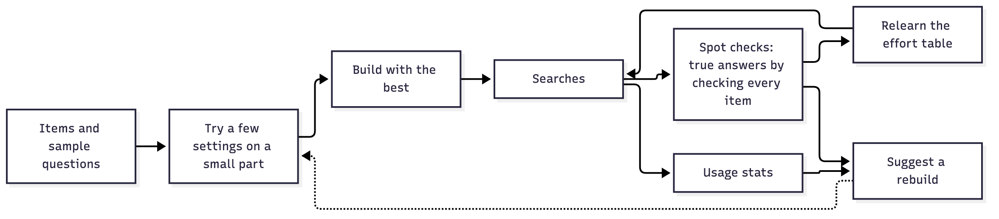
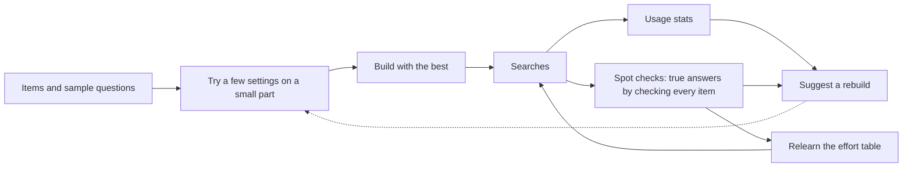

# Spec: the Rust index

**In one line:** a fast, memory-lean vector search index in Rust that carries over the design that survived the experiments, with a Python package so the same tests can measure it against the same rivals.

## Where it comes from
The research lives in `../vector-index-experiments` (Steps 1 to 5; see its `HOW-TO-VERIFY.md` and `results/step5/REPORT.md`). This project starts from scratch and uses that work as the reference: what to build, which numbers to match, and which rivals to beat.

The design that survived, in plain words:
- **A flat link map** (DiskANN's method): every item keeps about 32 links to nearby items; a search walks the links.
- **Fix 4:** for "best score" data, links are built on flipped copies of the numbers (x / |x|²), so loud items stop hogging links.
- **Fix 1 (better version):** each question gets its own search effort, from a table learned on training questions.
- **Fix 3 (automatic) and Fix 8:** where training questions look unlike the items, links are added between each training question's answers, made twice at build.
- **Fix 7:** a deleted item's neighbours are repaired right away; question links are redone every 3,000 changes.
- **Fix 6:** memory holds a 1-byte copy of every number; searches walk on those and re-check the best 50 with the full numbers, which can stay on SSD.

Ideas that were tried and dropped stay out, including uneven link counts (Fix 9): every item gets the same number of link slots.

## What it must do
1. **Store items:** each one an id (a whole number) and a fixed-length list of numbers (32-bit floats).
2. **Three closeness formulas:** angle (cosine), best score (inner product), straight-line distance (L2).
3. **Build** from a batch of items, optionally with training questions (sample questions, never the test ones).
4. **Search:** the k closest items for each question.
   - Effort is set either by a target accuracy (the learned effort) or by a fixed list size.
   - Every search also reports how many checks it made, so results can be compared with the prototype.
5. **Change items one at a time:** add, delete, update.
   - A deleted item is never returned.
   - An updated item is found by its new numbers, never its old ones.
6. **Save and load:** to a folder. The full numbers can be loaded into memory or left on SSD and read only for the re-checks.
7. **Python package:** build, search, add, delete, update, save, load, memory report. Numpy arrays in and out, thread count per call.

## Quality targets, and how each is checked
- **Same quality as the prototype.** On each of the five 100,000-item slices, at each stage of the design:
  - checks per search at 95% (tuning questions) within 5% of the Python prototype's;
  - best accuracy within half a point.
  - Not exact equality: the build order comes from a different random generator, and sums of floats run in a different order, so a few links differ.
- **Changes.** The Step 5 pass rule, on the same change script (build with 90% of the items, then 10,000 adds, deletes and updates): within 1 point of a fresh build, no deleted or old items returned, memory within 5% of a fresh build.
- **Memory per item** (kept in memory): link slots (41 × 4 bytes) plus a degree, a 1-byte copy of every number, and the id. The full numbers stay on SSD.
- **Speed.** Measured exactly as the rivals were in Step 3: one core, batches of 1,000 test questions, middle of 5 timed runs, read off the speed-vs-accuracy curve at exactly 95%. Reported against HNSW, DiskANN, CoreNN, Glass, ScaNN and RoarGraph on the same Mac.
  - Target: faster than HNSW, DiskANN and CoreNN on every dataset where they reach 95%.
  - Aim: as close as we can get to Glass and ScaNN, the fastest rivals. Where we miss, the report says so.
- **Safe to share between threads:** many searches at once; changes one at a time.

## Out of scope here
- Full-size runs (1 million items), the GIST1M head-to-head at full size, the results page and the demo. Those are Step 6 of the experiments plan and come after this project. (The held-back datasets moved into part 2.)
- Graphics cards, filters on search, several machines, compression other than the 1-byte copies (part 2 adds 4-bit copies).

## Inputs (read-only)
- **Data:** `../vector-index-experiments/data/prepared/<dataset>/`: items (`slice.npy`), questions (`q_train`, `q_tune`, `q_test`), their true answers (`truth_*.npz`), the change script (`changes.npz`, `truth_change_cp*.npz`).
- **Reference numbers:** the experiments' `results/step5/runs/<stage>/<dataset>.json` (tuning questions, each stage of the design), `results/step5/test/` (test questions), `results/step5/changes/` (change test), and `results/step3/final/<tool>/<dataset>/best.json` (rivals).

## Done when
Every step in `STEPS.md` passes its check, and `REPORT.md` gives speed, memory and accuracy on the five datasets against the rivals, with every missed target stated plainly.

---

# Part 2: an index that fits itself to each dataset

**In one line:** the index picks its own settings for each dataset, watches how it is used, keeps its accuracy on target, and suggests rebuilds. Then it is tested on four datasets nobody tuned on.

**Why:** in part 1, each rival got its best settings per dataset, while ours used one setting everywhere. Tuning ours by hand for these five datasets would not carry over to new data. So the index tunes itself, from its own sample questions, the same way on every dataset.

Diagram source (mermaid — flowchart)

## What it must do
1. **Pick its own settings at build:** try a few on a small part of the data, keep the fastest that reaches the target.
2. **Keep usage stats:** searches, checks, effort used, and how unlike the items the questions look.
3. **Spot-check accuracy in use:** now and then, find a question's true answers by checking every item, and compare.
4. **Learn from use:** relearn the effort table from spot-checked questions, so accuracy stays on target when real questions differ from the sample ones.
5. **Suggest rebuilds:** for changes that need one (like links per item), say what to change and the expected gain, measured on a small trial build, not guessed.
6. **Cheaper checks:** make each check faster in the code. That helps every dataset.

## Fairness rules
- No setting is picked by hand for one dataset. The index picks, from its own sample questions, the same way everywhere.
- Test questions are used only for reports.
- **Held-back datasets**, run once at the end, reported as they come:
  - **arXiv:** paper summaries (text, like GooAQ);
  - **LAION:** photos searched with text (like Yandex);
  - **Yi:** an AI chatbot's memory, best score (like Llama);
  - **GIST1M:** photo features, straight-line distance (none of the five use it).
- Correctness of the straight-line formula is checked on our own data before the end, never on GIST1M.

## Targets
- **Self-picked settings:** on each of the five, within 10% of the speed of the best choice that a full search over the same choices finds.
- **Spot checks:** the accuracy estimate falls within its stated margin about 19 times in 20.
- **Learning from use:** when sample questions differ from real ones, accuracy returns to within 1 point of the target.
- **Suggestions:** they name the right change for an index built with poor settings, and predict the gain within 15%. For an index whose settings are already best, they suggest nothing.
- **Small overheads:** stats cost under 1% of search time, and spot checks at the default rate under 2%.
- **Speed:** closer to the fastest rival on every dataset than in part 1. The aim is to beat them.
- **Held-back datasets:** the same procedure, with the first run reported.

## Out of scope in part 2
- Tricks for one kind of data, like a map of Llama's few answer items or a scan mode for GloVe. They come back only if they switch on by themselves and hold up on held-back data.

# Part 3: closing the last three gaps

**In one line:** make each check cheaper, let the index pick how many answers to re-check, and give popular items more links, all picked by the index itself. Then test on three new held-back datasets, one like each dataset where a rival still wins.

**Why:** after part 2, three rivals are still faster, each for its own reason (from the recorded runs):
- **Yandex, Glass 1.10×:** we make fewer checks (989 against 1,141 per search), but each costs more (24 against 19 ns). We re-check 50 answers with the full numbers; Glass re-checks 15.
- **Llama, RoarGraph 1.69×:** it makes fewer checks (719 against 1,005), and cheaper ones. Its map is built around the sample questions' answers, and on Llama 3.6% of the items hold 99.5% of the answers.
- **GloVe, ScaNN 1.34×:** it scores about 15,000 items per search, against our 5,655 checks, at about a quarter of the cost each, by scanning buckets of items in order.

## What it must do
1. **Pick its own re-check count:** after the build, on the real index, try a few counts and keep the fastest at the target, as part 2 does for the copy size.
2. **Cheaper checks, same results:** make each check faster in the code, with builds and answers unchanged.
3. **More links for popular items:** items that show up in many sample questions' answers get more links, the rest fewer, and the popular ones sit together in memory. The tuning keeps this only where it is faster on the sample questions.

## Fairness rules
- As in part 2: no setting picked by hand for one dataset; test questions only for reports.
- **New held-back datasets**, chosen before any part 3 work and run once, at the end:
  - **NYTimes:** news articles, angle (like GloVe: in-distribution and hard for link maps). From ann-benchmarks, `nytimes-256-angular`.
  - **ImageNet:** photos searched with text captions (like Yandex and LAION). From VIBE, `imagenet-align-640-normalized`.
  - **Llama, second head:** another attention head of the same chatbot, best score (like Llama). Built the way VIBE built Llama (`vibe/datasets.py`: keys as items, queries as questions, first token and last 2,047 dropped, 1,000 test questions). The head was drawn before any data was read: `random.Random(23).choice` over the 19 heads in `ejaasaari/llama_heads` that are not Llama's (layer 12, head 15) gave layer 15, head 18.
- **The four held-back datasets of part 2 stay locked** during part 3 work, and are run again at the end. Their part 2 results remain the clean first-run record.

## Targets
- **Re-check count:** on each of the five, within 3% of the speed of the best count, found by trying every count, head-to-head; at the 95% target, accuracy stays at 94% or more.
- **Cheaper checks:** builds and answers identical; at least 5% faster on average over the five, and none more than 2% slower.
- **Popular items:** on Llama, at least 1.3× faster at 95% on the tuning questions than at the end of part 2; on the other four, not more than 2% slower (the tuning keeps it off where it does not pay).
- **Speed:** on the six datasets won in part 2, still ahead. The aim is to beat Glass on Yandex and RoarGraph on Llama, and to get closer to ScaNN on GloVe.
- **New held-back datasets:** the same procedure, with the first run reported, and the expected results written down before it.

## Out of scope in part 3
- A bucket scan mode for GloVe-like data, as ScaNN uses: a second kind of index.
- Storing each item's neighbours' copies next to its links: much more memory.

# Part 4: the full-size proof, and sharing

**In one line:** run the index and its fastest rivals on the full datasets instead of the 100,000-item samples, with the expected results written down first. Then share it: a results page, a demo and a one-page write-up.

**Why:** every number so far comes from 100,000-item samples. The full datasets are 2–15× bigger (188,000 to 1.45 million items), and bigger data can change who wins. This is Step 6 of the experiments plan (`../vector-index-experiments/STEP6-PROOF.md`), which part 1 left until now.

## What it must do
1. **Lock first:** record a fingerprint of the index's code and of the rivals' builds, and write down the expected results, before any full-size run.
2. **Full-size data:** true answers on the full items for the tuning questions, and for the training questions where RoarGraph needs them; a full-size change script.
3. **Our index at full size,** on all twelve datasets, with every default: it picks its own settings, as before.
4. **The rivals at full size,** each with its settings search on the tuning questions, then the test questions, as before:
   - the fastest rival on each dataset in the samples: Glass on eight, ScaNN on GloVe, RoarGraph on the three attention datasets;
   - any other rival within 1.3× of it in the samples: ScaNN on NYTimes;
   - HNSW on all twelve, as the best-known method.
5. **GIST1M against CoreNN** on its author's own settings, on the dataset its author tested on: one plain sentence with the speed and the memory.
6. **The change test at full size:** build with 90% of the items, then add, delete and update 10% each.
7. **Share:** a results page built from the results files, the GooAQ demo and a one-page write-up.

## Fairness rules
- **The code stays frozen.** If a full-size run finds a bug, the fix is reported with its effect, and every run it touches is done again.
- As before: tuning questions for every choice, ours and the rivals'; test questions only for reports; one machine, measured the same way.
- **The rivals were chosen from the sample results,** before any full-size run.
- **ScaNN's bucket counts grow with the items,** so each bucket holds as many items as in the samples' settings search (about 1,000, 330 or 100).
- **Before sharing:** each dataset's licence is checked before any of its text is shown; no photos are ever shown.

## Targets
- **Faster than HNSW** at 95% on every dataset where it reaches 95% (part 1's target, now at full size).
- **Against the fastest rivals:** no target. The results are checked against the expectations written in step 28 and reported as they come.
- **Changes:** drift under 1 point (or better than a fresh build), no deleted or old items returned, memory within 5% of a fresh build.
- **Results page:** every number on it is read from the results files, and a script checks this.
- **Demo:** its answers are the index's answers for the same question, and it shows the time taken.

## Out of scope in part 4
- DiskANN at full size, and CoreNN beyond GIST1M. In the samples, both were at least 2.6× slower than ours, and they take over half of the rivals' run time.
- Speed work: the code does not change.

# Part 5: steady builds, the change test, and a second way to search

**In one line:** make a fresh build pick the same settings every time, make Landmark pass the change test, and let the index scan buckets of short codes where that beats walking links (GloVe), as one more setting it picks for itself. Then run our side at full size again.

**Why:** part 4 left three things:
- **Builds are not steady:** a fresh build can be 11% faster or slower than the last one (step 30b), because the setting search keeps the faster of two close choices by any margin, so timing noise decides. With the same picks, a rebuild is identical and within 1% (step 30c).
- **Landmark missed the change test** by 0.08 points (step 32).
- **GloVe:** ScaNN is 1.35× as fast as we are. It groups the items into buckets, finds the closest buckets, and scores every item in them from short codes, read in order. Our link walk needs about 12,600 checks per question there, each a jump to a far-off place in memory.

## What it must do
1. **Steady picks:** first find which choices flip between fresh builds; then decide close calls by a rule that timing noise cannot tip, with ties going to the plainer choice.
2. **Changes:** find why Landmark's accuracy falls further after many changes than a fresh build's, and fix it in the change code.
3. **Bucket search, in the same index:**
   - the index can also group its items into buckets, and answer a question by scanning the closest buckets' short codes, then re-checking the best with the full numbers;
   - the setting search times it against the link walk on the sample questions and keeps the faster, as it does for its other settings;
   - one index, one build, one search call, one file: adds, deletes, updates, saving, the SSD mode and the target accuracy work with either way of searching.
4. **A new held-back dataset:** GloVe with 100 numbers per word (ann-benchmarks' glove-100-angular, 1.18 million words), locked before the bucket work starts, its rivals run at full size, and tested once at the end.
5. **Our side at full size again,** on all twelve datasets and the new one, with the code frozen first. The rivals' part 4 runs stand.

## Fairness rules
- As before: tuning questions for every choice, test questions only for reports, one machine.
- The bucket search is designed on the twelve datasets' tuning questions only. GloVe-100 stays locked until the end, and its expected result is written down first.
- Part 4's results stay on record as they are; part 5 reports its own.

## Targets
- **Steady:** three fresh builds of each dataset pick the same settings. At full size, on Yandex and ImageNet (the two that moved in step 30b), their speeds are within 3% of each other.
- **Changes:** drift under 1 point on all twelve at full size, with nothing deleted or outdated returned and memory within 5% of a fresh build.
- **GloVe:** the bucket search is picked there, and it is at least 1.25× part 4's speed. The aim: faster than ScaNN.
- **No losses:** still ahead of the fastest rival on the eleven datasets won in part 4.
- **GloVe-100 (held back):** the expected result written down first; the first run reported as it comes.

## Out of scope in part 5
- Rerunning the rivals on the twelve datasets.
- A second index type: the bucket search is a way of searching the same index, not a separate one.

## Changed during part 5
- **The bucket search is not built in** (steps 40 and 41). Trained harder, it reached 1.17× our link walk on full GloVe but only 0.88× ScaNN, and the rule agreed with the user was to build it in only if it beat ScaNN. Its code stays as a recorded experiment. GloVe stays our one loss, and the GloVe target above is not met.
