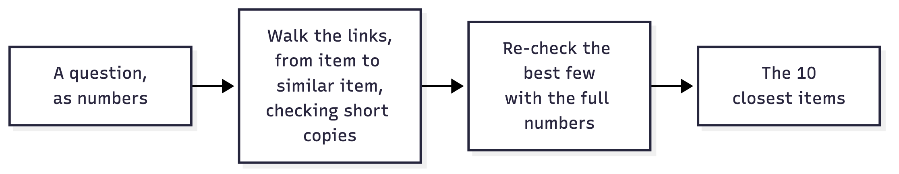
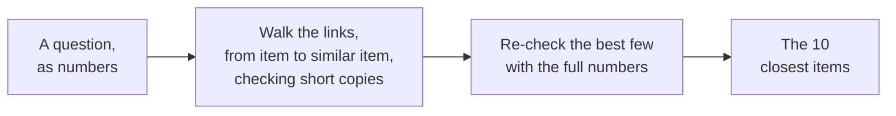
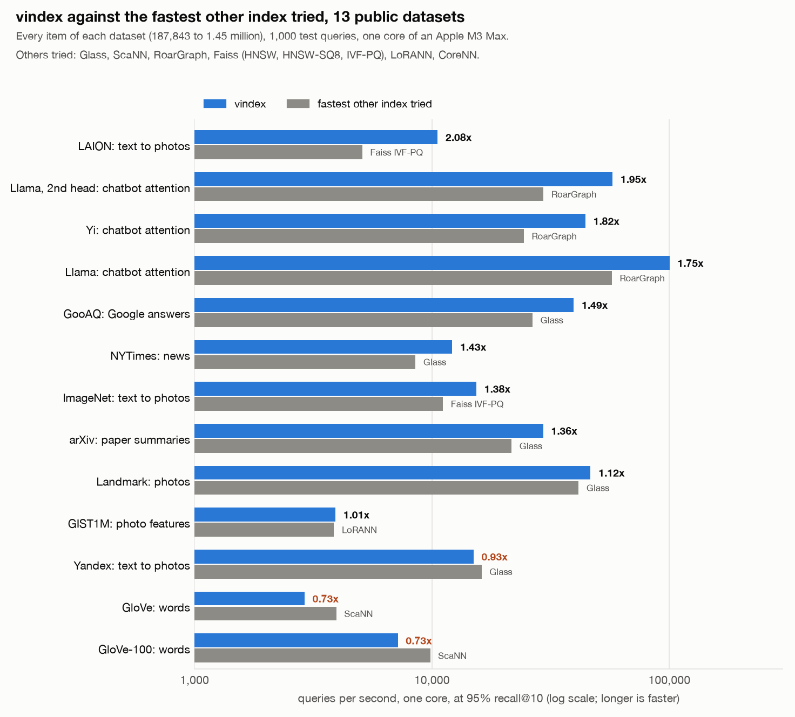

# vindex: finding the closest match among millions, fast

**What it is.** AI models turn a text, a photo or a word into a list of a few hundred numbers. Things that mean the same get similar numbers. vindex is a search index for these lists: given a question, it finds the 10 closest items among millions, without checking every one. It is written in Rust and used from Python.

**How a search works.**

Diagram source (mermaid — flowchart)

- When the index is built, each item is linked to a few similar items.
- A search starts at one item and keeps moving to whichever linked item is closest to the question.
- On the way it checks short copies of the numbers, then re-checks the best few with the full numbers.
- It picks its own settings for each dataset from sample questions, and keeps itself on target as items are added, deleted or changed.

**How we tested it.**
- **13 public datasets,** 187,843 to 1.45 million items each: Google's answers to real questions, word lists, photos, research papers, news, and the inner workings of chatbots.
- **Against the fastest rival on each dataset.** Glass, ScaNN, RoarGraph and CoreNN ran where earlier tests on 100,000-item samples found them fastest. After the code was frozen, Faiss (three kinds) and LoRANN ran on all thirteen. hnswlib ran too, but it has no vector code for Apple chips, so Faiss's HNSW takes its place. SymphonyQG and NGT-QG were not tried: their fast code is for Intel and AMD chips only.
- **One rule for speed:** questions answered per second on one processor core, when each index finds 95% of the true 10 closest items. Every index ran on the same Mac, measured the same way (ScaNN in a Linux container on it).
- **No peeking:**
  - every setting was picked on tuning questions, and speeds were measured on other test questions. The test questions did measure progress between rounds;
  - eight datasets were each held back for one round of building. Only the last, GloVe-100, was held back until the very end;
  - the code was frozen, and the expected results written down, before the final runs.

**What we found.**

- **Fastest on 9 of 13 datasets:** 1.12× to 2.08× the speed of the fastest rival. Level on GIST1M (1.01×, LoRANN) and Yandex (0.93×, Glass): within 10% counts as level.
- **Faiss and LoRANN, added after the freeze, cut our lead** on LAION and ImageNet (Faiss's bucket search) and on GIST1M (LoRANN): GIST1M went from 1.35× to 1.01×.
- **Wider settings grids for the rivals, tried later, made Glass faster** on Yandex and Landmark: Yandex went from 1.08× to 0.93×, Landmark from 1.34× to 1.12×. ScaNN, run on all 13 later, was not the fastest on any dataset it had skipped.
- **2.51× to 8.61× as fast as HNSW** (Faiss's, which has vector code for Apple chips). On the three chatbot datasets HNSW never finds 95%.
- **17.1× as fast as CoreNN** on GIST1M, the dataset CoreNN's author tested on, using its author's settings (part 4). CoreNN keeps its items in a database on disk, so this compares different designs.
- **Bigger data helped us:** in the samples we were only level with Glass on three datasets. With every item, Glass slowed down more than we did.
- **Changes:** after adding 10% more items, deleting 10% and updating 10%, accuracy stayed within 1 point of a fresh build on all 13 datasets. No deleted item ever came back.
- **Steadier builds:** three fresh builds of a dataset now pick the same settings on 11 of 12 (5 of 12 before), and those are within 1.0% of each other's speed.

**What we did not achieve.**
- **GloVe and GloVe-100:** ScaNN is 1.36× and 1.37× as fast as we are. On GloVe Faiss's bucket search is faster too (we are 0.77×), and on GloVe-100 Glass (we are 0.93×). It scans groups of short codes instead of walking links. We built that way of searching too, but it did not beat ScaNN, so it was left out.
- **Fully steady builds:** one sample (ImageNet) still flips between two settings, and in the final run Yandex's build picked differently from three made just before it, so Yandex came out 17% slower than in part 4.
- **Memory:** at the speeds above, we use about as much memory as Glass, or a little less, and more than RoarGraph, ScaNN, Faiss's bucket search and LoRANN. With the full numbers left on the SSD we use 0.17 to 0.70 times HNSW's memory, but answer 2 to 23 times fewer questions per second.
- **The rivals' settings and machine:** each tried 9 settings at first; where a pick sat at the edge of that grid, the next step out was tried until it no longer did (16 to 160 links, build effort up to 800), and their authors may still know better ones. Glass and RoarGraph ran at full size only where they were fastest on samples, and that pick missed: Faiss and LoRANN, run everywhere later, beat it on three datasets. They were written for Intel and AMD chips first, and on this Mac some ran without their own vector code: the README lists which. ScaNN ran in a Linux container on the Mac.
- **Our own guesses:** before the last round of changes we wrote down 8 results; 3 were wrong and 1 half right.

**Where to look.**
- [The results page](https://srir84.github.io/vector-index-rust/page/results.html) (`page/results.html`): every number, with a chart for each dataset. A script checks every number against the results files.
- `REPORT.md` has all five parts, with every table. `STEPS.md` has each step, its check and its result.
- [vector-index-experiments](https://github.com/srir84/vector-index-experiments): the rivals' scripts, versions, patches and every result.
- `demo/`: ask a question of GooAQ's 1.45 million Google answers, on your own machine.
