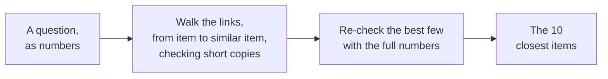
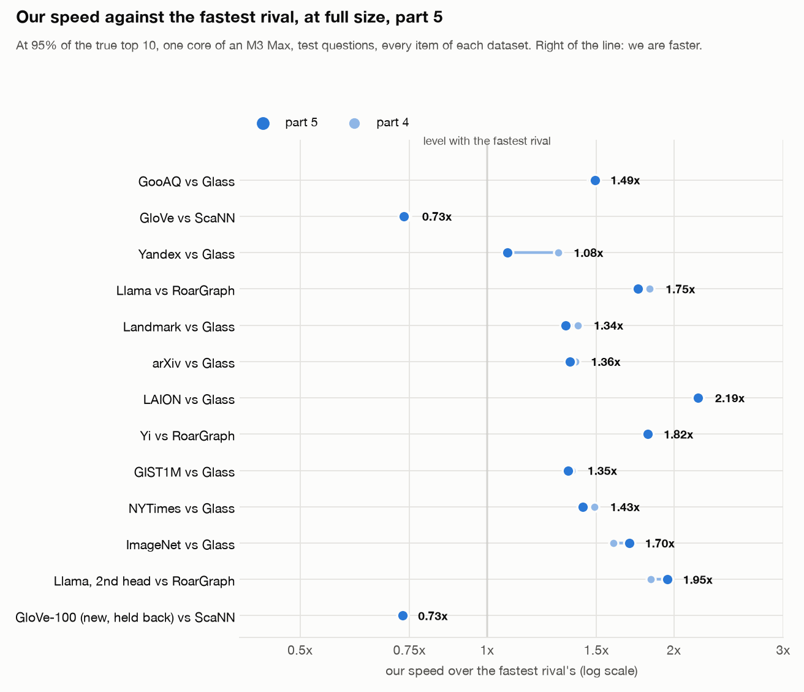

# vindex: finding the closest match among millions, fast

**What it is.** AI models turn a text, a photo or a word into a list of a few hundred numbers. Things that mean the same get similar numbers. vindex is a search index for these lists: given a question, it finds the 10 closest items among millions, without checking every one. It is written in Rust and used from Python.

**How a search works.**

Diagram source (mermaid — flowchart)

- When the index is built, each item is linked to a few similar items.
- A search starts at one item and keeps moving to whichever linked item is closest to the question.
- On the way it checks short copies of the numbers, then re-checks the best few with the full numbers.
- It picks its own settings for each dataset from sample questions, and keeps itself on target as items are added, deleted or changed.

**How we tested it.**
- **13 public datasets,** 187,843 to 1.45 million items each: Google's answers to real questions, word lists, photos, research papers, news, and the inner workings of chatbots.
- **Against the fastest rival on each dataset,** chosen from earlier tests on 100,000-item samples, plus HNSW, the best-known method, on all thirteen.
- **One rule for speed:** questions answered per second on one processor core, when each index finds 95% of the true 10 closest items. Every index ran on the same Mac, measured the same way.
- **No peeking:**
  - every setting was picked on tuning questions, and speeds were measured on other test questions;
  - eight datasets were held back while the index was built, the last one until the very end;
  - the code was frozen, and the expected results written down, before the final runs.

**What we found.**

- **Fastest on 11 of 13 datasets:** 1.08× to 2.19× the speed of the fastest rival.
- **6.84× to 17.36× as fast as HNSW,** wherever HNSW finds 95%. On the three chatbot datasets it never does.
- **17.1× as fast as CoreNN** on GIST1M, the dataset CoreNN's author tested on, using its author's settings, with 76% less memory (part 4).
- **Bigger data helped us:** in the samples we were only level with Glass on three datasets. With every item, Glass slowed down more than we did.
- **Changes:** after adding 10% more items, deleting 10% and updating 10%, accuracy stayed within 1 point of a fresh build on all 13 datasets. No deleted item ever came back.
- **Steadier builds:** three fresh builds of a dataset now pick the same settings on 11 of 12 (5 of 12 before), and those are within 1.0% of each other's speed.

**What we did not achieve.**
- **GloVe and GloVe-100:** ScaNN is 1.36× and 1.37× as fast as we are. It scans groups of short codes instead of walking links. We built that way of searching too, but it did not beat ScaNN, so it was left out.
- **Fully steady builds:** one sample (ImageNet) still flips between two settings, and in the final run Yandex's build picked differently from three made just before it, so Yandex came out 17% slower than in part 4.
- **Memory:** at the speeds above, we use about as much memory as Glass, or a little less, and more than RoarGraph and ScaNN. With the full numbers left on the SSD we use 0.17 to 0.70 times HNSW's memory, but answer 2 to 23 times fewer questions per second.
- **The rivals' settings:** each tried up to 9 settings, and their authors may know better ones. ScaNN ran in a Linux container on the Mac.
- **Our own guesses:** before the last round of changes we wrote down 8 results; 3 were wrong and 1 half right.

**Where to look.**
- `page/results.html`, the results page: every number, with a chart for each dataset. Download it and open it in a browser. A script checks every number against the results files.
- `REPORT.md` has all five parts, with every table. `STEPS.md` has each step, its check and its result.
- `demo/`: ask a question of GooAQ's 1.45 million Google answers, on your own machine.
