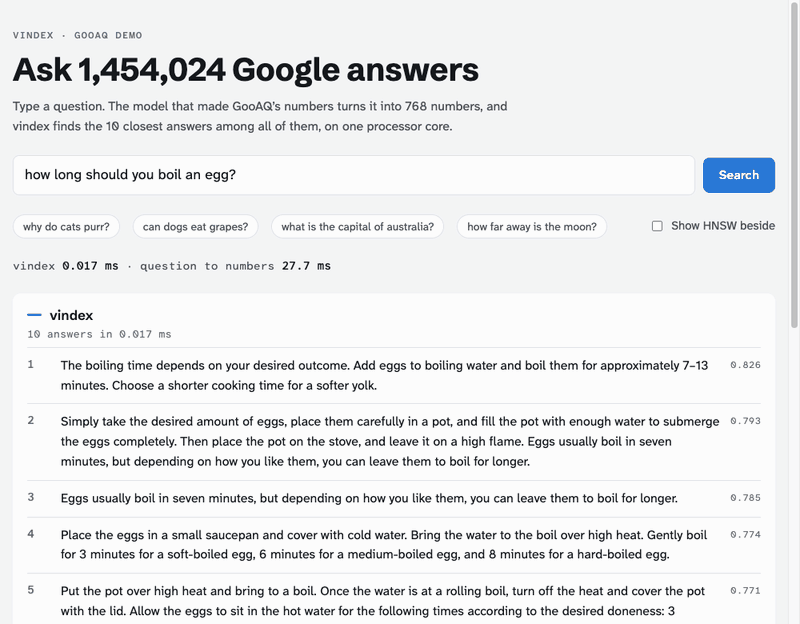

# Ask GooAQ: the demo

Type a question, and the page shows the 10 closest of GooAQ's 1.45 million Google answers, found by vindex on one processor core, with the time taken. A switch shows HNSW's answers beside ours.



- **The model** that made GooAQ's numbers for the benchmark (all-distilroberta-v1) turns the question into 768 numbers.
- **vindex** searches its index of every GooAQ item, built as in step 29: every default, with the 20,000 training questions.
- **HNSW** (hnswlib 0.8.0) searches the same items, with the settings its own search picked at full size (step 30).
- **Each time shown** is the middle of 25 runs of the same search. The time to turn the question into numbers is shown on its own.
  - Repeating one search keeps what it reads in the chip's caches, so these times are shorter than the benchmark's, which come from 1,000 different questions (`page/results.html`).
- **It runs on this machine only.** GooAQ's text may not be used for any commercial purpose.

## Run it
1. **Make its environment** (Python 3.13). vindex is the package frozen in step 28 (kept in `validate/results/step28-package/`, its fingerprint as recorded), linked in, not rebuilt:
   ```sh
   uv venv demo/.venv --python 3.13
   uv pip install --python demo/.venv/bin/python torch sentence-transformers pyarrow hnswlib==0.8.0
   mkdir -p demo/.venv/frozen
   ln -s "$PWD/validate/results/step28-package/vindex" demo/.venv/frozen/vindex
   echo "$PWD/demo/.venv/frozen" > demo/.venv/lib/python3.13/site-packages/vindex-frozen.pth
   ```
2. **Get GooAQ's text** into `demo/data/gooaq/` (Hugging Face's `sentence-transformers/gooaq`, its `pair` files) and its licence into `demo/data/gooaq-licence/` (from `allenai/gooaq` on GitHub).
3. **Prepare the data** (about 70 minutes on an M3 Max, most of it turning 1,476,024 answers into numbers on the Apple GPU; it writes 14 GB to `demo/work/`):
   ```sh
   demo/.venv/bin/python -I demo/prepare.py
   ```
   - It finds each benchmark item's answer text by its numbers: the model, run on every unique answer, gives numbers that match the item's (step 3 of `prepare.py`). 1,453,978 of the 1,454,024 items have their text.
   - `demo/work/answer_numbers.npy` (4.5 GB) is needed only while preparing, and can be deleted after.
4. **Start it,** then open http://127.0.0.1:8034/:
   ```sh
   demo/.venv/bin/python -I demo/server.py
   ```

## How it is checked
`demo/.venv/bin/python -I validate/step34.py` asks the demo 100 of GooAQ's own questions (a fixed random draw), and checks:
- **each text shown is the one its numbers were made from:** the model, run on the text, gives that item's numbers;
- **the answers are the index's own:** the same index files, searched directly with the same question numbers, give the same 10 items in the same order, for vindex and for HNSW;
- **the licence allows showing the text,** and the page credits it.

## Credits
- **Answers:** GooAQ, by AllenAI, under the Apache 2.0 licence, with the request that it not be used for any commercial purpose.
- **Numbers:** the all-distilroberta-v1 model (sentence-transformers). The benchmark's GooAQ file is VIBE's (CC BY 4.0).
