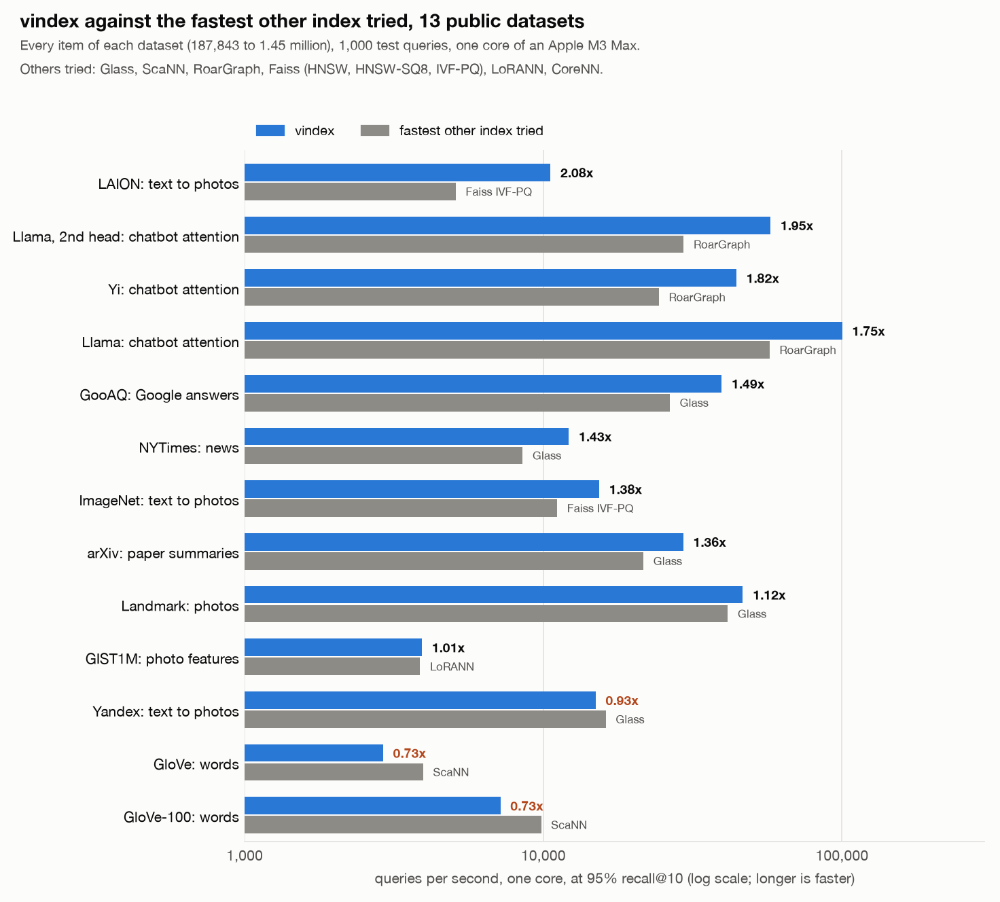

# The benchmark: vindex against other vector indexes

The README has the short version. This page has every number behind it, how it was measured, and every caveat. [The results page](https://srir84.github.io/vector-index-rust/page/results.html) has a chart for each dataset, and `REPORT.md` every table from all five parts. Paths in this page are from the repository's top folder.

## The result

**The test:** 13 public datasets, every item of each (187,843 to 1.45 million), 1,000 test queries each, one core of an Apple M3 Max, at 95% recall@10.

- **Faster than the fastest other index tried on 9 of 13,** by 1.12× to 2.08×.
- **Level on 2:** GIST1M (1.01× LoRANN) and Yandex (0.93× Glass). Within 10% counts as level: timing a pair again moved its ratio by up to 16% (part 4: Yandex 1.30× then 1.10×, ImageNet 1.60× then 1.86×).
- **On chatbot attention vectors** (Llama, Yi; maximum inner product): 1.75× to 1.95× RoarGraph, which is built for such queries. Faiss HNSW never reaches 95% there.
- **Faiss and LoRANN were added after the code was frozen** (step 47). They became the fastest other index on LAION and ImageNet (Faiss IVF-PQ) and on GIST1M (LoRANN), and cut vindex's lead there: LAION 2.19× to 2.08×, ImageNet 1.70× to 1.38×, GIST1M 1.35× to 1.01×.
- **The rivals' gaps were closed after that** (step 48): wider settings grids for Glass, RoarGraph and Faiss IVF-PQ, ScaNN on all 13, and LoRANN with sample queries on the text-to-photo datasets. Glass got faster on Yandex and Landmark, which cut vindex's lead there from 1.08× to 0.93× and from 1.34× to 1.12×. No other dataset's fastest other index or ratio changed.
- **Slower on the two GloVe word datasets:** ScaNN is 1.36× and 1.37× as fast. On GloVe Faiss IVF-PQ is faster too (vindex 0.77×), and on GloVe-100 Glass (vindex 0.93×). GloVe-100 is the one dataset kept untouched until the code was frozen.
- **On all 16 cores the lead is smaller,** and Glass wins on Landmark, GIST1M and Yandex (vindex 0.61×, 0.68× and 0.87×).

## The numbers

| Dataset | vindex (queries/s) | Fastest other index | vindex ÷ it | at 90% | all 16 cores | Faiss HNSW |
|---|---|---|---|---|---|---|
| LAION: text to photos | 10,566 | Faiss IVF-PQ 5,088 | **2.08×** | **1.58×** | **1.07×** | 1,410 |
| Llama, 2nd head: chatbot attention | 57,607 | RoarGraph 29,507 | **1.95×** | **2.06×** | **1.50×** | never 95% |
| Yi: chatbot attention | 44,284 | RoarGraph 24,371 | **1.82×** | **1.94×** | **2.02×** | never 95% |
| Llama: chatbot attention | 100,112 | RoarGraph 57,226 | **1.75×** | **1.95×** | **1.53×** | never 95% |
| GooAQ: Google answers | 39,545 | Glass 26,512 | **1.49×** | **1.50×** | **1.14×** | 10,923 |
| NYTimes: news | 12,169 | Glass 8,523 | **1.43×** | **1.16×** | **1.38×** | 1,414 |
| ImageNet: text to photos | 15,379 | Faiss IVF-PQ 11,120 | **1.38×** | **1.43×** | **1.25×** | 2,416 |
| arXiv: paper summaries | 29,407 | Glass 21,627 | **1.36×** | **1.15×** | **1.19×** | 8,926 |
| Landmark: photos | 46,560 | Glass 41,448 | **1.12×** | **1.21×** | 0.61× | 18,565 |
| GIST1M: photo features | 3,921 | LoRANN 3,866 | **1.01×** | **1.02×** | 0.68× | 1,347 |
| Yandex: text to photos | 14,971 | Glass 16,182 | 0.93× | 0.89× | 0.87× | 4,153 |
| GloVe: words | 2,907 | ScaNN 3,956 | 0.73× | 0.72× | 0.67× | 518 |
| GloVe-100: words | 7,184 | ScaNN 9,828 | 0.73× | 0.93× | 0.90× | 1,971 |

- **vindex ÷ it:** one core, 95% recall@10, read off each index's effort-vs-recall curve at exactly 95%.
- **Landmark:** Glass already passes 95% at its quickest setting, so its speed there is a floor and vindex's 1.12× is at most that.
- **At 90%:** the same at 90% recall, against the fastest other index there. On GooAQ, Llama, Landmark and arXiv both already pass 90% at their quickest setting, so that cell compares their quickest settings.
- **One core:** each index ran with one thread (Faiss with `omp_set_num_threads(1)`; its CPU time matched its wall time). The M3 Max has 12 performance and 4 efficiency cores. A macOS storage scan used up to 4.3 other cores during vindex's runs.
- **Only recall@10 at 90% and 95% was compared.** The effort sweeps stop shortly after 95%, so nothing here says how the indexes compare at 99%.
- **All 16 cores:** queries/s with every core, at the setting each index picked for 95% on the tuning queries (test recall 94% to 97%). This compares the indexes roughly, not at an exact recall. ScaNN's container had 8 cores.
- **Faiss HNSW:** plain float32 HNSW (`IndexHNSWFlat`, with Faiss's NEON code), at the links and build effort hnswlib picked. It replaces hnswlib here, which has no ARM SIMD. Faiss HNSW is 1.7× to 4.5× as fast as hnswlib was on the same data.

Made by `tools/draw_report.py readme`. vindex's numbers come from `validate/results/step42-ours.json`. The others' come from [vector-index-experiments](https://github.com/srir84/vector-index-experiments) (`results/step6/`, `results/step7/` for GloVe-100, `results/step8/` for Faiss and LoRANN, and `results/step9/` for the gap-closing runs; `results/current.json` says which result is current for each index and dataset).
## Read this before trusting the numbers
- **The machine favours vindex.**
  - vindex has hand-written NEON kernels and was built with profile-guided optimization (`tools/build_py_pgo.sh`).
  - The others were written for x86 first. Faiss and LoRANN have ARM NEON code. hnswlib has none: its distance loop compiles to scalar code without fast-math, so Faiss HNSW stands in for it. Glass's ARM kernels are commented out upstream, so it runs plain loops, which the compiler auto-vectorizes. RoarGraph's x86 SIMD goes through the SIMDe translation layer. ScaNN ran in a Linux container on the same Mac.
  - On an x86 server the results may differ.
- **Not every strong index was tried.**
  - SymphonyQG, the fastest on many VIBE datasets, needs AVX-512, which Apple chips lack.
  - NGT-QG was not run: its quantized-graph search is x86-only.
  - "Fastest other index" means the fastest of Glass, ScaNN, RoarGraph, CoreNN, Faiss (HNSW, HNSW-SQ8, IVF-PQ) and LoRANN.
- **The rivals were first picked on samples, and that missed some.** Glass, ScaNN and RoarGraph ran at full size only where they were fastest on 100,000-item samples (ScaNN also on NYTimes, where it was within 1.3×), and CoreNN on GIST1M, the dataset its author tested on. Faiss and LoRANN, run on all 13 later, beat the sample-picked rival on LAION, ImageNet and GIST1M. ScaNN then ran on all 13 too (step 48) and was not the fastest on any of the 10 new ones: 0.35× to 5.8× Faiss IVF-PQ's speed, and on ImageNet 7,392 queries/s against Faiss IVF-PQ's 11,120. Glass and RoarGraph still ran only where the samples picked them.
- **The others' settings grids were widened where their picks sat at the edge** (step 48). Each graph index first tried 9 settings (32/64/96 links × build effort 100/200/400); Glass picked 96 links on 5 of 9 datasets and RoarGraph on all 3. Step 48 tried one step past each edge (16 to 160 links, build effort up to 800) until the pick was inside the tried settings: Glass got faster on Yandex (128 links, build effort 800: 1.17× as fast) and Landmark (24 links: 1.19×), and RoarGraph kept 96 links. Faiss IVF-PQ added one bucket per 100 items to its 2 bucket counts and took it only on GIST1M. Picks still at the edge of what was tried: Glass's build effort 800 on Yandex (the cap) and build effort 100 on arXiv (the least), RoarGraph's build effort 100 on Llama, and ScaNN's most buckets on Llama and Llama2, where it reaches a tenth to a fifth of RoarGraph's speed. ScaNN tried 6 settings (5 on GooAQ, where one crashed twice) and LoRANN 2 to 4 (each with and without sample queries where both ran). Faiss HNSW and HNSW-SQ8 reused hnswlib's and Glass's picks without a grid of their own. Their authors may know better settings.
- **vindex learns from sample queries.** It uses 20,000 training queries from the same source as the test queries, for its search budget and its extra links. RoarGraph uses them too. LoRANN got them on the three chatbot datasets, as its documentation advises for queries unlike the items, and in step 48 also on Yandex, LAION and ImageNet, where vindex turned its question links on. There they did not help on the tuning queries (Yandex and LAION slower, ImageNet the same), and LoRANN stays behind Faiss IVF-PQ on ImageNet. The others use none.
- **The held-back datasets were held back for one round each.**
  - The project was built in five rounds. Eight datasets were each kept out of one round, then measured, then used like the others.
  - Only GloVe-100 was untouched until the code was frozen, and there vindex came third.
  - Test queries were never used to pick vindex's settings, but they measured progress between rounds. Step 12 kept speed-only code changes (answers unchanged) when they were at least 10% faster on test queries.
- **Can be rerun:** every script, setting and result is in this repo and in [vector-index-experiments](https://github.com/srir84/vector-index-experiments), including each index's version, commit and patch (`baselines/VERSIONS.md`).

## Where it is not better
- **Build time:** slower than the fastest other index on all 13 datasets: 1.4× (Yandex) to 24× (Yi) as long, and 454× on GIST1M, where LoRANN builds in 2 seconds. Trying settings is part of it: on 100,000-item samples, builds took 2.6–7× longer with it. `tune="off"` skips it, at a cost in speed.
- **Memory:** with everything in memory, 0.92× to 2.13× the fastest other index's memory per item: less on GooAQ and arXiv, about the same as Glass on Yandex, Landmark and NYTimes, and more against RoarGraph (1.5× to 1.56×), Faiss IVF-PQ and LoRANN (1.26× to 1.32×) and ScaNN (1.66× and 2.13×). It can leave the full vectors on SSD, using 0.14× to 1.25× the fastest other index's memory, but then answers 2–23× fewer queries per second.
- **Unreachable items:** a few items can't be found by any search: 0 to 1,209 per dataset, out of up to 1.45 million (GIST1M has the most).
- **Scope:** one machine, tested up to 1.45 million items, no filtered search, and fast only on Apple silicon.

## What each piece adds
Each dataset built at full size with the settings its tuned build picked, then again with one piece changed. Speed at 95% recall@10 on test queries, one core, as a share of the first row (step 46, `validate/step46_pieces.py`). "–": the piece was not in use there.

| Change | GooAQ | GloVe | LAION | Llama |
|---|---|---|---|---|
| As the tuning picked (tuning off, same settings) | 40,019/s | 3,056/s | 10,858/s | 108,604/s |
| One list size for every query (no per-query budget) | 0.94× | 0.78× | 0.92× | 1.00× |
| 8-bit codes instead of 4-bit | 0.90× | – | – | – |
| No codes: the walk compares full float32 vectors | 0.38× | 0.58× | 0.44× | 0.84× |
| No question links | – | – | 0.94× | 0.03× |
| No popular links | – | – | – | 0.42× |
| Graph built on x, not x / ‖x‖² | – | – | – | never 95% (best 56%) |
| Default settings (r 32, alpha 1.2, 8-bit, re-check 50) | 0.90× (the 8-bit row) | 0.49× | 0.90× | 0.88× |

- **The codes** matter most on wide data: the walk on full vectors is 0.38× to 0.58× as fast on GooAQ, GloVe and LAION, and 0.84× on Llama (128 numbers).
- **The per-query budget** makes it 1.06× to 1.28× as fast (0.78× to 0.94× without it), and changes nothing on Llama.
- **On Llama, the question links and the Möbius graph are what make it work:** without them it is 0.03× as fast, or never reaches 95%. The popular links make it 2.4× as fast.
- **The tuning's picks against the defaults:** 1.1× to 2.0×.
