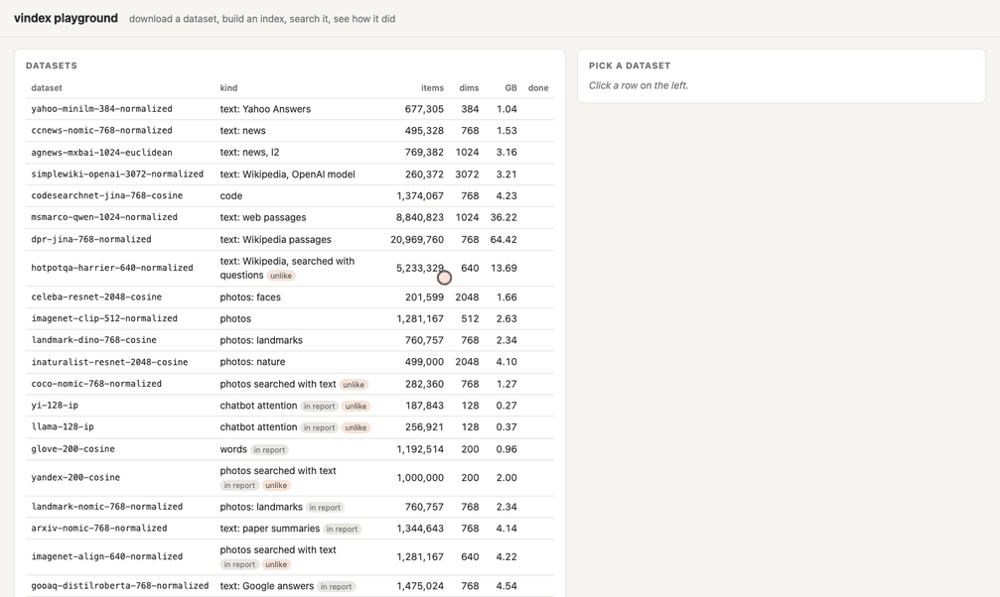

# Playground: try vindex on a public dataset

Download a dataset, build an index on it, search it, and see how it did, from the command line or a browser page. Every index setting is vindex's default: it picks its own.



*Waits are sped up about 7×; the page's own clock shows the real time. Recorded with `tools/record_playground.py`.*

## Before you start
Do the main README's **Install** first, then add one package, for reading the dataset files:
```sh
uv pip install --python .venv h5py         # or: .venv/bin/pip install h5py
```
All commands below run from the repo's top folder.

## From the command line
```sh
.venv/bin/python playground/play.py list                               # the datasets, and what is done on each
.venv/bin/python playground/play.py run yahoo-minilm-384-normalized    # download, build, search: all three
```
Or one step at a time:

| Command | What it does | Yahoo (M3 Max) |
|---|---|---|
| `play.py get NAME` | Downloads the file to `playground/data/` | 1.04 GB |
| `play.py build NAME` | Builds the index on all cores, showing each step, and saves it to `playground/work/NAME/` | 4 min 42 s |
| `play.py search NAME` | Searches the file's 1,000 test questions at targets 0.90, 0.95 and 0.99, on one core, and checks every answer | a few seconds |
| `play.py show NAME` | Shows what the last build and search found | |

Build once, then search as often as you like: `search` loads the saved index. Options:
- `build --threads 4`: use 4 cores.
- `search --target 0.95`: one target.
- `search --list-size 50 100`: fixed effort instead of a target.
- `search --search-threads 8`: spread the questions over 8 cores.

What `run yahoo-minilm-384-normalized` printed:
```
built 657,305 items of 384 numbers (cos) in 282 s on all cores
  sample questions: 20,000 items set aside;  test questions: the file's own
  memory: 423 MB (644 bytes per item); full numbers 1,010 MB can stay on SSD
  settings picked: 48 links per item, slack 1.3, 8-bit copies, re-check 50
  questions unlike items: ratio 1.03, question links off;  items no search can reach: 0

1,000 test questions, 1 thread(s), true top 10 from the file or by checking every item
  effort              found  questions/s    checks
  target 0.9          91.0%       44,257       727
  target 0.95         93.6%       35,839       836
  target 0.99         98.4%       18,170     1,516
```
- **found:** the share of the true 10 closest items that the search returned. A target is aimed at, not promised: here 0.95 gave 93.6%.
- **checks:** items measured per question. Checking every item would take 657,305.
- **questions/s:** on one core. Your numbers will differ a little from run to run.

## From a browser
```sh
.venv/bin/python playground/play.py ui          # then open http://127.0.0.1:8035/
```
1. Click a dataset.
2. Press **Download**, then **Build**, then **Search**. The page shows each step as it runs, how far linking has got, and the time so far.
3. After a build: the time, memory, the settings the index picked, and whether the questions look unlike the items.
4. After a search: found share, questions per second and checks at each target, with a chart.
5. **One question up close:** the 10 items found for one test question, which of them are in the true top 10, and which true ones it missed.

The page runs one job at a time and listens on this machine only.

## The datasets
`list` shows 22 files from [VIBE](https://huggingface.co/datasets/vector-index-bench/vibe) (CC BY 4.0): text, photos, code and chatbot attention, from 187,843 to 20.9 million items.
- **in-report:** one of the 13 datasets in `REPORT.md`. The others are new to vindex.
- **unlike:** the questions look unlike the items, for example text searching photos. These files bring their own sample questions.
- **Size:** building Yahoo (a 1.04 GB file) took 5.7 GB of memory at its peak. Bigger files need more. `dpr-jina-768-normalized` (64 GB) needs more than 128 GB.
- **Good first picks:** `yi-128-ip` (0.27 GB, a few minutes in all) and `yahoo-minilm-384-normalized` (1 GB, about 5 minutes).

## How it checks the answers
- **Sample questions** (the index learns its effort from them): the file's own (`learn`) when it has them, else 20,000 items set aside and not stored. This matches every result in `REPORT.md`.
- **True answers:** the file's own top 100 (`neighbors`), less any items set aside. If that leaves fewer than 10, it checks every item for that question instead.

## Your own data
Put an HDF5 file in `playground/data/`, for example `mine.hdf5`, and it shows up in `list` and on the page as `mine`:

| Inside the file | Needed? | What it is |
|---|---|---|
| `train` | yes | the items: one row of numbers each (float) |
| `test` | no | questions. Without it, 1,000 items are set aside as questions. |
| `neighbors` | no | each question's true closest rows of `train`. Without it, the true answers are found by checking every item. |
| `learn` | no | sample questions, when your questions look unlike your items |
| attribute `distance` | no | `normalized`, `cosine`, `euclidean` or `ip`. Without it, pass `--metric cos`, `ip` or `l2` to `build`. |

```python
import h5py, numpy as np
with h5py.File("playground/data/mine.hdf5", "w") as f:
    f["train"] = my_vectors.astype(np.float32)     # n x dims
    f.attrs["distance"] = "cosine"
```

## Files
| File | What it holds |
|---|---|
| `play.py` | the command line and the browser page's server |
| `lab.py` | the work both use: download, build, search, check |
| `ui.html` | the browser page |
| `data/` | downloaded datasets (not in git) |
| `work/NAME/` | each dataset's saved index, `build.json`, `search.json`, the true answers and the rows set aside (not in git) |
